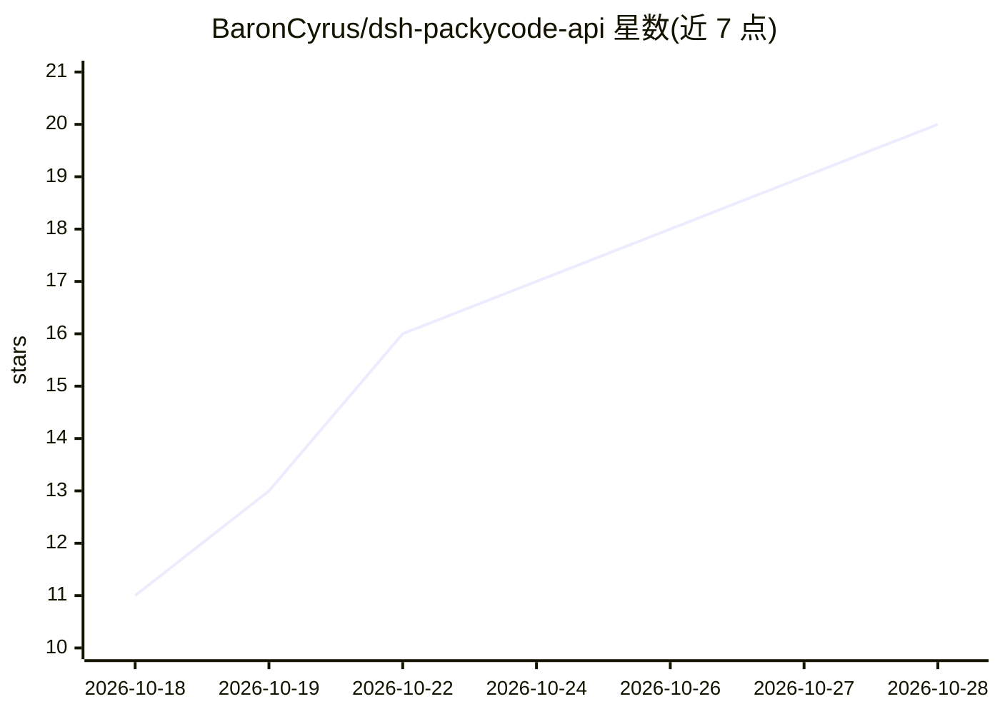

# BaronCyrus/dsh-packycode-api

⭐ 20 · JavaScript · MIT · 推送 2026-10-27 · [GitHub](https://github.com/BaronCyrus/dsh-packycode-api) · 个人维护 · 中文 README

**DSH 插件：用 PackyCode API Key 接入多模型并轮换 Key、显示余额**

DeepSeek Harness（DSH）的插件：安装后在模型选择器出现 PackyCode 分组，通过插件内 HTTP 调用网关的 DeepSeek、GPT 等模型；cc 分组的 Claude 会话改由本机 Claude Code CLI 作为 agent 执行，DSH 负责界面与授权。支持多 Key 按顺序轮换（额度尽/Key 被拒自动切换）、按分组选 Key、每 Key 余额展示，另含 PackyCode 网页搜索路由、图片生成与编辑（独立图片 Key）、可换模型的自动授权审查。凭据仅存于 DSH 凭据文件。给使用 DSH 且持有 PackyCode Key 的用户。

## 筛选速览

| 维度 | 判定 | 备注 |
|---|---|---|
| AI 角色 | `ai-ecosystem` | LLM/agent 周边工具 |
| 许可风险 | `permissive` | MIT |
| 部署形态 | `library` | 以包/库形式分发 |
| 模型依赖 | — | README 未给出锁定关系 |
| 硬件要求 | — | 无带数字的原话,不猜 |
| 安装摩擦 | `low` | 无编译、无系统依赖或容器化 |
| 成熟度 | — | 结构信号不足 |

## 能力要点

- 安装后自带 PackyCode 模型分组，无需改 YAML 或另配 provider
- 多 Key 按顺序轮换，额度用尽或 Key 被拒时自动切换并由重试接手
- cc 分组的 Claude 会话由本机 Claude Code CLI 执行，授权与计划审阅在 DSH 界面完成
- 每 Key 余额/额度/重置周期展示，网页搜索与图片生成可走 PackyCode

## 适用场景

- 在 DSH 里用 PackyCode 的 Key 调用多个模型而不改配置文件
- 多个 API Key 自动轮换并逐个查看剩余额度
- 让 Claude 会话经官方 Claude Code CLI 在 cc 分组 Key 上运行

## 场景标签

 · 领域:LLM 基础设施/客户端插件

## 证据(README 行号)

> L23: |**自带模型路由**|安装后模型选择器出现 `PackyCode` 分组，不需要配置 provider，也不用改 `cordis.patch.yml`|
> L25: |**多 Key 按顺序使用**|额度用尽或 Key 被拒绝时自动切到下一个可用 Key；失败的那一步由重试接手|
> L40: 先准备好 **DeepSeek Harness** 和 **PackyCode（PackyAPI）的 API Key**。尚未安装 DSH，可查看 DSH 官方说明。还没有 API Key 的，可以通过这个邀请链接注册 Packy

## 星数曲线

2026-10-18 11 → 2026-10-28 20（+9）

---
*卡片 v1 · prompt 1.4 · 生成 2026-10-28 · 置信度 high · 依据 README sha `afa65ceb8981` · [字段定义](../../DATASET.md)*
