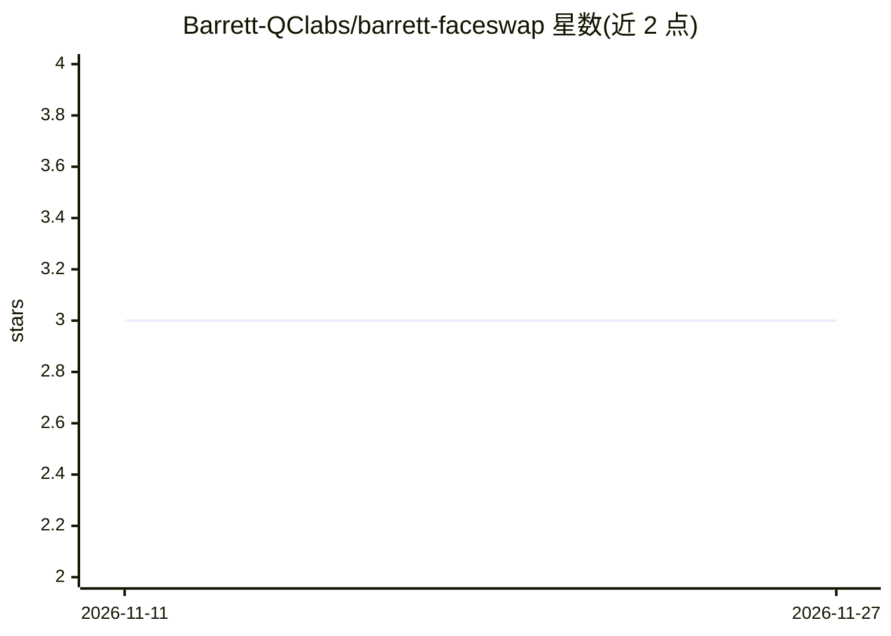

# Barrett-QClabs/barrett-faceswap

⭐ 3 · Python · MIT · 推送 2026-11-01 · [GitHub](https://github.com/Barrett-QClabs/barrett-faceswap) · 个人维护 · 中文 README

**给需要换脸换声的用户：一键图像/视频/实时换脸与声音克隆**

开源换脸与声音克隆工具：图像、视频、实时摄像头三类换脸，支持多人映射、源人脸库、可选 OpenVoice V2 音色替换。工程路径为检测（SCRFD/det_10g）、对齐（ArcFace w600k_r50）、ONNX 换脸（7 种可选 swapper）、可选 GFPGAN/CodeFormer 修复与贴回。内置负责任使用机制：默认开启授权确认、AI 生成水印、可插拔内容过滤与审计日志。代码 MIT，模型权重（如 inswapper_128）由用户自行下载且为非商业许可。提供 CLI 与 Gradio 界面，中英双语。

## 筛选速览

| 维度 | 判定 | 备注 |
|---|---|---|
| AI 角色 | `ai-native` | 本体是模型或模型工具 |
| 许可风险 | `permissive` | MIT |
| 部署形态 | `library` | 以包/库形式分发 |
| 模型依赖 | — | README 未给出锁定关系 |
| 硬件要求 | — | 无带数字的原话,不猜 |
| 安装摩擦 | `medium` | 含编译或系统依赖之一 |
| 成熟度 | — | 结构信号不足 |

## 能力要点

- 图像/视频/实时摄像头换脸，多人映射与源人脸库
- 多种 ONNX swapper 可选（hyperswap/inswapper_128/simswap/ghost 等）与像素增强
- 默认开启的合规包：授权确认、水印、内容过滤、审计日志
- 中英双语界面与文档，支持断点续跑与模型 sha256 校验下载

## 适用场景

- 对图片和视频做指定人脸的换脸
- 通过摄像头实时换脸（Linux 支持 v4l2loopback）
- 为合成输出自动添加水印与审计记录

## 场景标签

`图像视频处理` `语音合成` · 领域:内容生成

## 证据(README 行号)

> L9: Barrett FaceSwap swaps a face in a still image or a video. It wires the usual engineering path: detect a face, align
> L31: - **中英双语界面 / Bilingual UI (中文 default, English).** The header control labeled 语言 switches every label, including bo
> L48: - Realtime webcam: `barrett-faceswap live` runs capture, detect, swap, and output on three threads. Bounded queues 

## 星数曲线

2026-11-11 3 → 2026-11-27 3（+0）

---
*卡片 v1 · prompt 1.4 · 生成 2026-11-22 · 置信度 high · 依据 README sha `0b6cd9af441c` · [字段定义](../../DATASET.md)*
