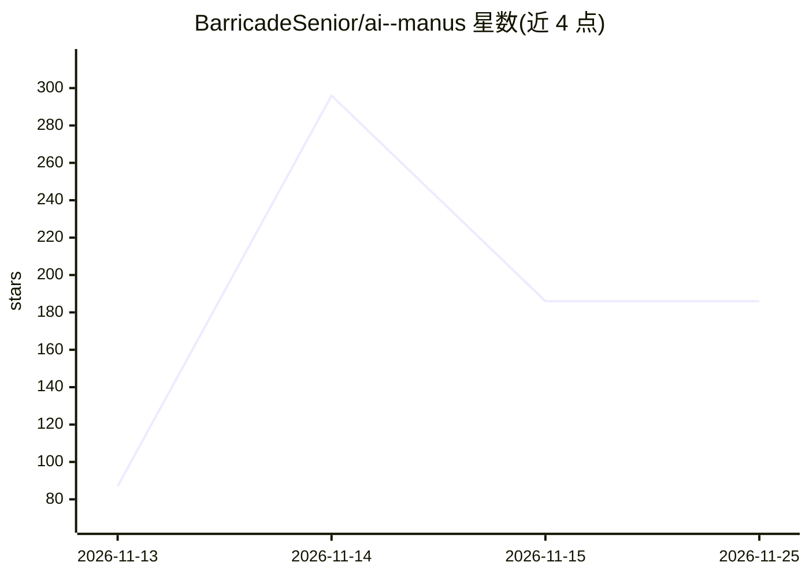

# BarricadeSenior/ai--manus

⭐ 186 · Apache-2.0 · 推送 2026-11-15 · [GitHub](https://github.com/BarricadeSenior/ai--manus) · 个人维护

**面向个人用户的通用自主 AI Agent：代跑代码与控制浏览器**

README 将 Manus 描述为一个自主 AI agent，可在沙箱环境中运行代码、控制浏览器（导航网页、填写表单、采集信息），并执行多步骤任务，面向家庭、学习与轻量办公场景的学生、远程工作者等非开发者用户。核心机制为代码执行与浏览器操作结合的单一流水线，可在脚本与浏览器动作间衔接。README 未给出具体的安装命令、技术栈或模型接入方式，仅提供系统兼容性表与使用步骤说明。

## 筛选速览

| 维度 | 判定 | 备注 |
|---|---|---|
| AI 角色 | `ai-native` | 本体是模型或模型工具 |
| 许可风险 | `permissive` | Apache-2.0 |
| 部署形态 | `None` |  |
| 模型依赖 | — | README 未给出锁定关系 |
| 硬件要求 | — | 无带数字的原话,不猜 |
| 安装摩擦 | `low` | 无编译、无系统依赖或容器化 |
| 成熟度 | — | 结构信号不足 |

## 能力要点

- 自主执行代码脚本完成任务
- 浏览器控制：导航、填表、信息采集
- 代码与浏览器动作可在同一任务流中衔接
- 面向非开发者的家庭、学习与轻量办公场景

## 适用场景

- 让 agent 代为检查网页更新或填写重复表单
- 整理研究笔记、运行小脚本
- 远程会话中快速检查系统页面与整理诊断步骤

## 场景标签

`浏览器自动化` · 领域:效率与自动化

## 证据(README 行号)

> L10: - **Autonomous Code Execution:** Manus AI agent runs code on its own to complete tasks, so you can focus on decisio
> L18: Manus is an autonomous AI agent designed to run code and control a browser on your behalf. Instead of acting like a

## 星数曲线

2026-11-13 87 → 2026-11-25 186（+99）

---
*卡片 v1 · prompt 1.4 · 生成 2026-11-17 · 置信度 low · 依据 README sha `0f78ee3a5dd2` · [字段定义](../../DATASET.md)*
