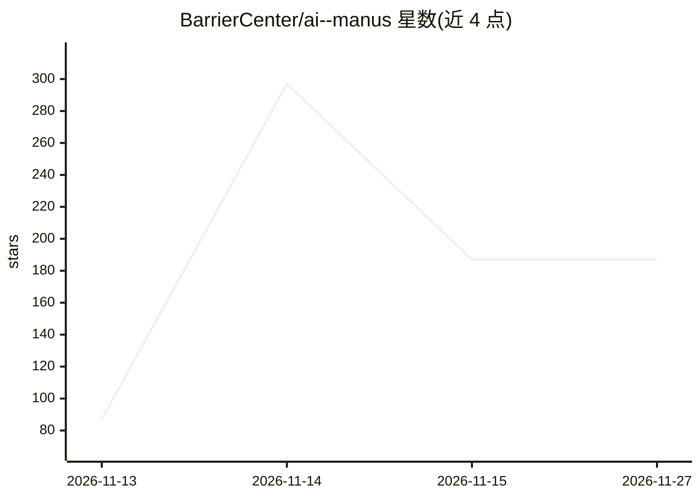

# BarrierCenter/ai--manus

⭐ 187 · Apache-2.0 · 推送 2026-11-15 · [GitHub](https://github.com/BarrierCenter/ai--manus) · 组织维护

**自主执行代码与浏览器操作的通用 AI Agent 助手**

Manus 是面向个人用户的自主 AI agent：用户以自然语言下达任务，agent 自行编写并执行脚本、打开网页、与页面元素交互，完成多步骤任务，可在脚本与浏览器流程间衔接。定位为家庭、学习与轻量办公场景的后台个人助手，非企业平台。README 给出 CPU/内存等兼容性参考表（建议 8GB 以上内存）与上手步骤说明，但未提供具体安装命令、代码仓库结构或模型接入方式等可验证细节。

## 筛选速览

| 维度 | 判定 | 备注 |
|---|---|---|
| AI 角色 | `ai-native` | 本体是模型或模型工具 |
| 许可风险 | `permissive` | Apache-2.0 |
| 部署形态 | `None` |  |
| 模型依赖 | — | README 未给出锁定关系 |
| 硬件要求 | — | 无带数字的原话,不猜 |
| 安装摩擦 | `low` | 无编译、无系统依赖或容器化 |
| 成熟度 | — | 结构信号不足 |

## 能力要点

- 自主编写并执行代码完成任务
- 浏览器控制：导航网页、填写表单、采集信息
- 脚本与浏览器动作在同一任务流中衔接
- 面向个人/轻量场景的后台个人助手模式

## 适用场景

- 让 agent 代为执行网页信息采集与表单填写等重复操作
- 学生组织研究笔记、运行小脚本
- 轻量办公中跨多页面收集信息并汇总

## 场景标签

`AI 助手` `编码 Agent` `浏览器自动化` · 领域:效率与自动化

## 证据(README 行号)

> L10: - **Autonomous Code Execution:** Manus AI agent runs code on its own to complete tasks, so you can focus on decisio
> L18: Manus is an autonomous AI agent designed to run code and control a browser on your behalf. Instead of acting like a

## 星数曲线

2026-11-13 87 → 2026-11-27 187（+100）

---
*卡片 v1 · prompt 1.4 · 生成 2026-11-17 · 置信度 low · 依据 README sha `a3d88e202bf0` · [字段定义](../../DATASET.md)*
