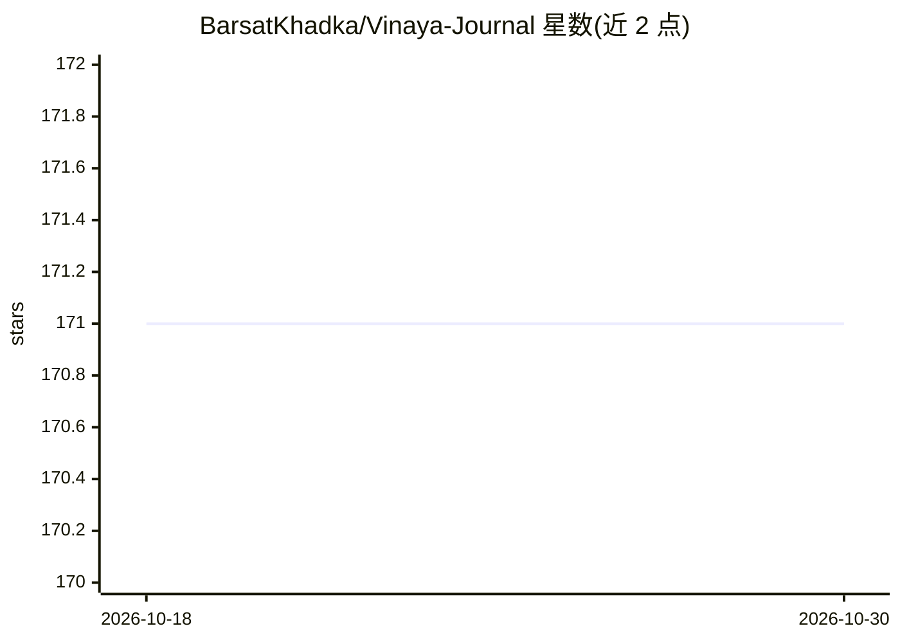

# BarsatKhadka/Vinaya-Journal

⭐ 171 · TypeScript · MIT · 推送 2026-07-04 · [GitHub](https://github.com/BarsatKhadka/Vinaya-Journal) · [官网](https://vinaya-journal.vercel.app) · 个人维护

**本地离线优先的 AI 日记桌面应用，带 RAG 语义搜索**

基于 Electron + React 前端与 Spring Boot 后端的跨平台日记桌面应用：通过 ChromaDB 构建检索增强生成（RAG）管线，支持对日记条目的语义搜索，并提供基于本地 Ollama 的上下文对话、情绪追踪与可视化。设计目标为离线优先与隐私保护，数据全部留在本机，不依赖云端服务。运行方式为在本地运行前端、后端与 AI 服务全栈，详细步骤见 docs/LOCALSETUP.md，采用 MIT 许可证。

## 筛选速览

| 维度 | 判定 | 备注 |
|---|---|---|
| AI 角色 | `ai-enhanced` | 去掉 AI 部分产品仍成立 |
| 许可风险 | `permissive` | MIT |
| 部署形态 | `None` |  |
| 模型依赖 | local-ok | 支持本地模型 |
| 硬件要求 | — | 无带数字的原话,不猜 |
| 安装摩擦 | `low` | 无编译、无系统依赖或容器化 |
| 成熟度 | — | 结构信号不足 |

## 能力要点

- ChromaDB RAG 管线支持基于语义而非关键词的日记搜索
- 接入本地 Ollama 的上下文对话，AI 可理解日记内容
- 离线优先：无云端、无服务器，数据全部留在本机
- 情绪追踪与随时间可视化

## 适用场景

- 我想写一本数据不出本机的私密日记
- 按含义而非关键词检索过往日记条目
- 与了解我日记内容的 AI 对话，辅助自我反思与冥想练习

## 场景标签

`RAG` `语义搜索` · 领域:知识与检索

## 证据(README 行号)

> L4: Vinaya Journal is a **cross-platform** journaling desktop app that integrates local AI via Ollama and a retrieval-au
> L31: - **Personalized Chat with Vinaya’s Contextual Ollama AI**

## 星数曲线

2026-10-18 171 → 2026-10-30 171（+0）

---
*卡片 v1 · prompt 1.4 · 生成 2026-10-22 · 置信度 high · 依据 README sha `d2bf64eaabbf` · [字段定义](../../DATASET.md)*
