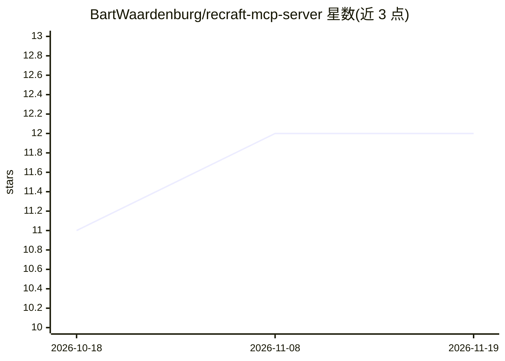

# BartWaardenburg/recraft-mcp-server

⭐ 12 · TypeScript · MIT · 推送 2026-11-03 · [GitHub](https://github.com/BartWaardenburg/recraft-mcp-server) · [官网](https://www.npmjs.com/package/recraft-mcp) · 个人维护

**给 MCP 客户端接入 Recraft 图像生成与处理 API 的服务器**

非官方社区维护的 Model Context Protocol 服务器，封装 Recraft API，提供 16 个工具：文本生成图像、图到图变换、局部重绘、背景替换/生成、去背景、区域擦除、光栅转 SVG 矢量化、清晰/创意放大，以及基于 1-5 张参考图创建自定义风格和查询账户余额。支持按工具集过滤、缓存 TTL 与限流重试配置，可配置 recraftv2/v3/v4 等模型。通过 NPX、Docker、Smithery 安装，支持 Claude Desktop/Code、VS Code、Cursor、Windsurf 等客户端；需自备 Recraft API token。

## 筛选速览

| 维度 | 判定 | 备注 |
|---|---|---|
| AI 角色 | `ai-ecosystem` | LLM/agent 周边工具 |
| 许可风险 | `permissive` | MIT |
| 部署形态 | `self-host` | docker 或自建部署 |
| 模型依赖 | — | README 未给出锁定关系 |
| 硬件要求 | — | 无带数字的原话,不猜 |
| 安装摩擦 | `low` | 无编译、无系统依赖或容器化 |
| 成熟度 | — | 结构信号不足 |

## 能力要点

- 16 个 MCP 工具覆盖生成、处理（去背景/矢量化/放大）与风格管理
- 支持 recraftv2/v3/v4 等多个模型与 5 类基础风格及子风格
- 通过 RECRAFT_TOOLSETS 过滤暴露给 LLM 的工具集
- 提供 NPX、Docker、Smithery 多种安装方式与限流重试、缓存配置

## 适用场景

- 在 Claude Desktop 或 Cursor 里用自然语言生成和编辑图像
- 批量去除图片背景并转成 SVG 矢量图
- 用参考图创建自定义风格并复用生成系列图像

## 场景标签

`图像生成` `图像视频处理` · 领域:内容生成

## 证据(README 行号)

> L3:  MCP server for AI image generation, transformation, and style management via the Recraft API
> L18: **16 tools** for image generation, processing, and style management — all accessible through the Model Context Prot
> L61: claude mcp add recraft-mcp -e RECRAFT_API_TOKEN=your-api-token -- npx -y recraft-mcp

## 星数曲线

2026-10-18 11 → 2026-11-19 12（+1）

---
*卡片 v1 · prompt 1.4 · 生成 2026-11-18 · 置信度 high · 依据 README sha `4bed45c5322b` · [字段定义](../../DATASET.md)*
