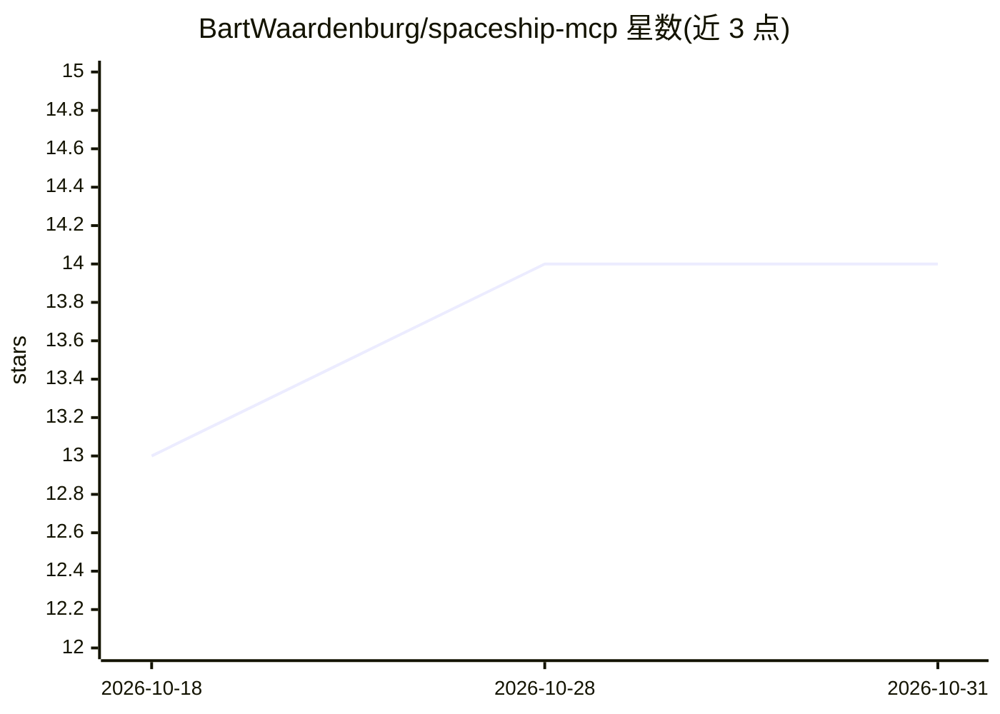

# BartWaardenburg/spaceship-mcp

⭐ 14 · TypeScript · MIT · 推送 2026-10-13 · [GitHub](https://github.com/BartWaardenburg/spaceship-mcp) · [官网](https://www.npmjs.com/package/spaceship-mcp) · 个人维护

**通过自然语言管理 Spaceship 域名/DNS 的 MCP 服务器**

面向 Spaceship API 的社区版 Model Context Protocol (MCP) 服务器，用 TypeScript 编写：向 MCP 兼容的 AI 客户端（Claude Code、Codex CLI、Gemini CLI、VS Code、Cursor 等）暴露 48 个工具，覆盖域名注册/续费/转移、13 种 DNS 记录类型的类型安全创建、联系人管理、SellerHub 域名交易及 DNS 对齐分析；另提供 5 个 MCP Resources、9 个 MCP Prompts、响应缓存与速率限制重试。需要 Spaceship API key 与 secret，通过 npx 或 Docker 运行，官方声明与 Spaceship 无隶属关系。

## 筛选速览

| 维度 | 判定 | 备注 |
|---|---|---|
| AI 角色 | `ai-ecosystem` | LLM/agent 周边工具 |
| 许可风险 | `permissive` | MIT |
| 部署形态 | `self-host` | docker 或自建部署 |
| 模型依赖 | locked-api |  |
| 硬件要求 | — | 无带数字的原话,不猜 |
| 安装摩擦 | `low` | 无编译、无系统依赖或容器化 |
| 成熟度 | — | 结构信号不足 |

## 能力要点

- 48 个工具覆盖 Spaceship API 全部功能，含完整域名生命周期管理
- 13 种 DNS 记录类型的专用类型安全创建工具
- 5 个 MCP Resources、9 个 MCP Prompts、资源订阅变更通知
- 响应缓存、指数退避重试与按 API scope 的细粒度权限配置

## 适用场景

- 在 AI 客户端中用自然语言创建和管理 DNS 记录
- 通过对话完成域名注册、续费、转移等生命周期操作
- 在 SellerHub 上架待售域名并生成结账链接
- 用 DNS 对齐分析核对预期与实际记录是否一致

## 场景标签

 · 领域:开发者工具/域名与 DNS 管理

## 证据(README 行号)

> L10: A community-built Model Context Protocol (MCP) server for the Spaceship API. Manage domains, DNS records, contacts,
> L72: |Client|Easiest install|
> L141: - **Required env vars:** `SPACESHIP_API_KEY`, `SPACESHIP_API_SECRET`

## 星数曲线

2026-10-18 13 → 2026-10-31 14（+1）

---
*卡片 v1 · prompt 1.4 · 生成 2026-10-31 · 置信度 high · 依据 README sha `8927e8933e62` · [字段定义](../../DATASET.md)*
