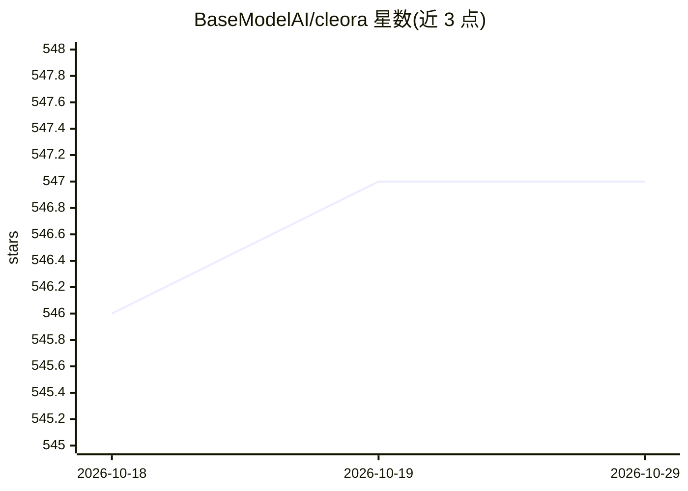

# BaseModelAI/cleora

⭐ 547 · Jupyter Notebook · NOASSERTION · 推送 2026-04-02 · [GitHub](https://github.com/BaseModelAI/cleora) · [官网](https://cleora.ai) · 组织维护

**图嵌入引擎：单次矩阵乘法为异构图生成确定性实体嵌入**

Cleora（pycleora）是用 Rust 实现、CPU 运行的图嵌入库：通过迭代 Markov 传播加每轮白化，以稀疏矩阵乘法一次覆盖所有随机游走，无需负采样与 GPU，输出确定性嵌入。除自有算法外统一封装 ProNE、NetMF、DeepWalk、Node2Vec、HOPE 等 9 种算法，支持异构超图、有向/加权图、多尺度与监督微调等模式，并附带社区检测、MLP 分类、采样、调参、压缩、可视化等内置模块，提供 Python API 与 CLI。由 Synerise 团队创建，曾获 SIGIR/WSDM/Twitter RecSys/KDD Cup 竞赛名次，Zomato 案例用于推荐系统。

## 筛选速览

| 维度 | 判定 | 备注 |
|---|---|---|
| AI 角色 | `ai-native` | 本体是模型或模型工具 |
| 许可风险 | `none` | NOASSERTION |
| 部署形态 | `library` | 以包/库形式分发 |
| 模型依赖 | — | README 未给出锁定关系 |
| 硬件要求 | `cpu-ok` | |
| 安装摩擦 | `medium` | 含编译或系统依赖之一 |
| 成熟度 | — | 结构信号不足 |

## 能力要点

- 单次矩阵乘法计算所有随机游走，无负采样、确定性输出
- 统一 API 封装 9 种图嵌入算法（Cleora/ProNE/NetMF/DeepWalk/Node2Vec 等），单参数切换
- 原生支持异构超图、二部图、有向/加权图与归纳式新节点嵌入
- 附带 18 个内置模块：社区检测、MLP 分类、图采样、超参调优、嵌入压缩、可视化等

## 适用场景

- 为推荐系统、客户相似查找生成用户-商品图嵌入
- 对知识图谱、交易图做实体嵌入用于欺诈检测与实体对齐
- 在无 GPU 环境下对大规模图（百万级节点）快速产出可复现嵌入
- 在同一框架内对比多种图嵌入算法的精度、内存与耗时

## 场景标签

`推荐系统` · 领域:学习与行业

## 证据(README 行号)

> L5: Cleora computes all possible random walks in a single matrix multiplication .
> L101: |**Cleora**|Spectral / Random Walk|Iterative Markov propagation with per-iteration whitening — all random walks in
> L245: 4. **Single Matrix Multiplication = All Walks** — One sparse matrix multiplication captures *every possible random

## 星数曲线

2026-10-18 546 → 2026-10-29 547（+1）

---
*卡片 v1 · prompt 1.4 · 生成 2026-10-21 · 置信度 high · 依据 README sha `939bba0c4b28` · [字段定义](../../DATASET.md)*
