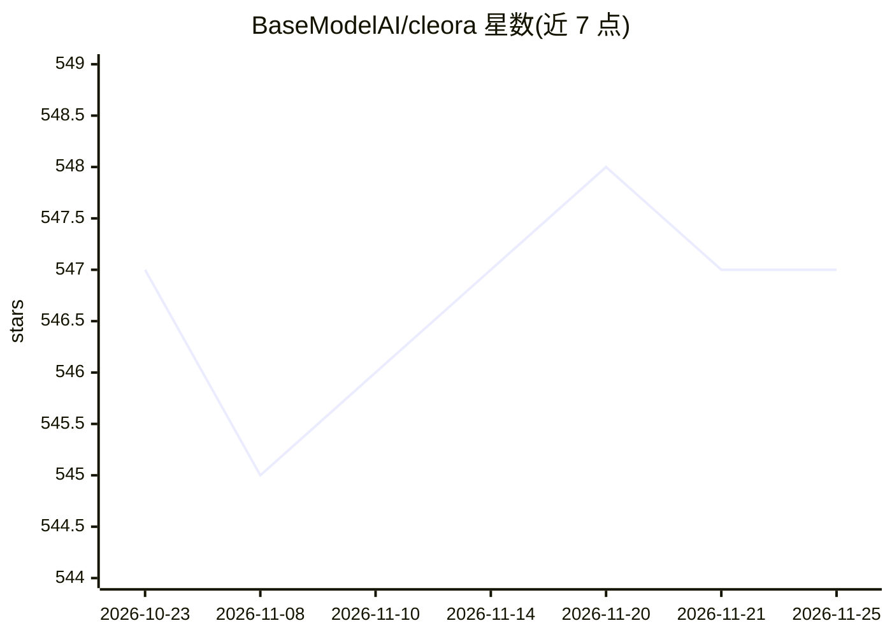

# BaseModelAI/cleora

⭐ 547 · Python · NOASSERTION · 推送 2026-11-19 · [GitHub](https://github.com/BaseModelAI/cleora) · [官网](https://cleora.ai) · 组织维护

**在 CPU 上秒级生成图/超图实体嵌入向量的开源模型库**

由 Synerise 团队开发的通用实体嵌入模型：通过迭代邻域平均（无采样、无训练、无 GPU）将图或超图转化为每节点一个向量，支持异构关系数据、加权边、二部图与归纳式新增节点（无需重训）。以 Python 包 pycleora 发布，含 embed/embed_inductive/scale_by_popularity 等 API 与 pycleora 命令行，NumPy 为唯一必需依赖；附一键复现的 26 图基准脚本与 9 种基线方法对比结果。

## 筛选速览

| 维度 | 判定 | 备注 |
|---|---|---|
| AI 角色 | `ai-native` | 本体是模型或模型工具 |
| 许可风险 | `permissive` | NOASSERTION |
| 部署形态 | `library` | 以包/库形式分发 |
| 模型依赖 | — | README 未给出锁定关系 |
| 硬件要求 | — | 无带数字的原话,不猜 |
| 安装摩擦 | `low` | 无编译、无系统依赖或容器化 |
| 成熟度 | — | 结构信号不足 |

## 能力要点

- 单步邻域平均生成嵌入，确定性输出（同输入逐位一致）
- 支持超图、加权边、二部数据与 embed_inductive 归纳式新增节点
- 提供 pycleora CLI（embed/info/similar）与 Python API
- 基准可用 benchmarks/replicate.sh 一条命令复现

## 适用场景

- 为购物篮/会话数据中的商品生成相似度检索向量
- 为节点分类和链接排序提供图特征
- 推荐系统中生成候选召回向量（如 people you may know）
- 图数据新增节点后无需重训即可获得向量

## 场景标签

`推荐系统` · 领域:学习与行业

## 证据(README 行号)

> L5:  Graph embeddings in seconds, on a CPU.
> L37: Cleora turns a graph or hypergraph into one vector per node by repeating a single step:
> L80: pip install pycleora

## 星数曲线

2026-10-23 547 → 2026-11-25 547（+0）

---
*卡片 v1 · prompt 1.4 · 生成 2026-11-25 · 置信度 high · 依据 README sha `3bc8f441e980` · [字段定义](../../DATASET.md)*
