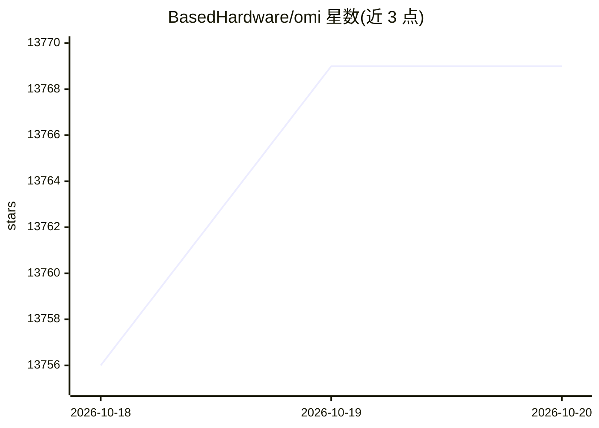

# BasedHardware/omi

⭐ 13,769 · Python · MIT · 推送 2026-10-19 · [GitHub](https://github.com/BasedHardware/omi) · [官网](https://omi.me) · 组织维护

**记录屏幕与对话并生成摘要行动项的 AI 可穿戴伴侣应用**

开源的 AI 记录工具：捕获屏幕画面与对话，实时转写、生成摘要与行动项，并提供带有完整记忆的 AI 聊天。覆盖桌面、手机与可穿戴设备三种形态，macOS 应用从源码构建并连接云端后端，Windows 由 Node.js 从源码运行，移动端提供 App Store 与 Google Play 安装。项目包含多个组件：Swift 桌面应用、Flutter 移动应用、Python/FastAPI 后端、nRF/Zephyr 固件及 ESP32-S3 的 Omi Glass 硬件，并提供 REST API 与多语言设备 SDK。

## 筛选速览

| 维度 | 判定 | 备注 |
|---|---|---|
| AI 角色 | `ai-native` | 本体是模型或模型工具 |
| 许可风险 | `permissive` | MIT |
| 部署形态 | `library` | 以包/库形式分发 |
| 模型依赖 | — | README 未给出锁定关系 |
| 硬件要求 | — | 无带数字的原话,不猜 |
| 安装摩擦 | `low` | 无编译、无系统依赖或容器化 |
| 成熟度 | — | 结构信号不足 |

## 动量与使用信号

- 维护:`active` — 距上次 push 0.7 天,年发版 100,366 位贡献者
- 涨星:近 1 天 **+13**(自 20261016 起算)
- 安装:npm 包 `copy` 月下载 123,782
- 平台:WINDOWS / MACOS / ANDROID / IOS · 协议:MCP

## 能力要点

- 实时转写屏幕与对话，生成摘要与行动项
- 支持桌面、手机与可穿戴设备多形态
- 提供 REST API、MCP Server 及 Python/Swift/RN 设备 SDK
- 开源可穿戴硬件（Omi 项链与 Omi Glass）设计公开

## 适用场景

- 佩戴可穿戴设备全程记录对话并回顾要点
- 在桌面端捕获屏幕内容并让 AI 记住所见所闻
- 基于设备 SDK 开发自己的音频流或聊天工具应用

## 场景标签

`语音识别` `聊天机器人` · 领域:对话与助手

## 证据(README 行号)

> L5: Omi captures your screen and conversations, transcribes in real-time, generates summaries and action items, and give
> L95: |Component|Path|Stack|
> L137: ## Omi Hardware

## 星数曲线

2026-10-18 13,756 → 2026-10-20 13,769（+13）

---
*卡片 v1 · prompt 1.4 · 生成 2026-10-18 · 置信度 high · 依据 README sha `ef681a191ba1` · [字段定义](../../DATASET.md)*
