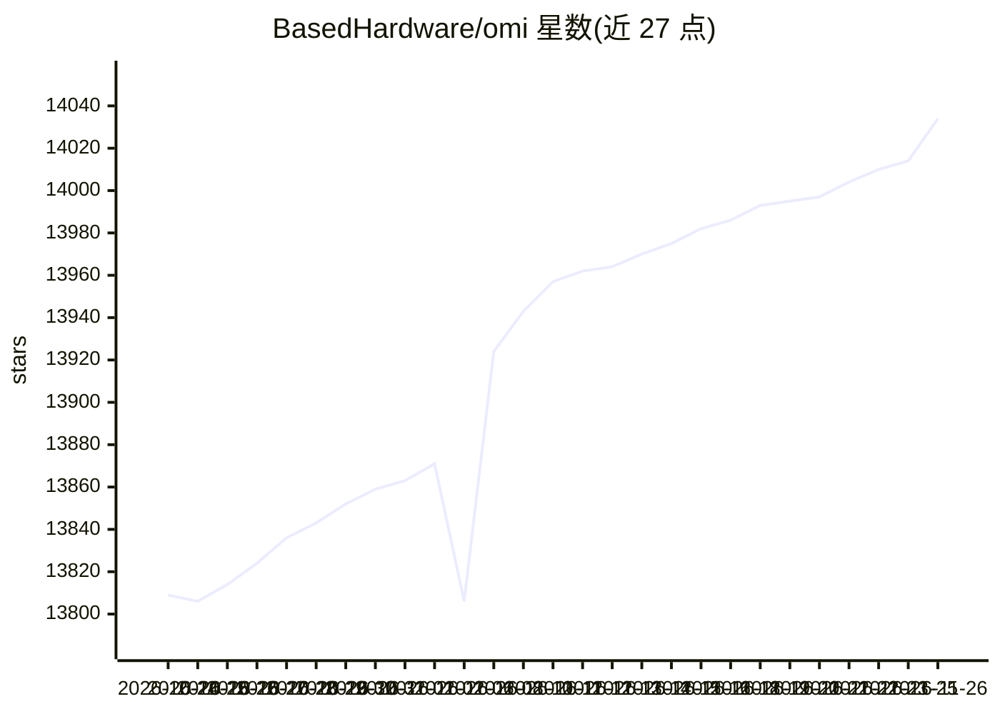

# BasedHardware/omi

⭐ 14,034 · Python · MIT · 推送 2026-11-25 · [GitHub](https://github.com/BasedHardware/omi) · [官网](https://omi.me) · 组织维护

**开源 AI 可穿戴平台：记录对话与屏幕并转为可查询记忆**

Omi 是一个开源 AI 可穿戴平台，包含项链式硬件、手机与桌面应用及后端：实时捕获对话与屏幕内容、转录、生成摘要与行动项，并提供可记忆所见所闻的 AI 聊天。仓库以 MIT 许可开源移动/桌面应用、后端、固件与硬件设计；托管 Omi Cloud 服务与付费计划在 omi.me 提供。技术栈覆盖 Swift、Flutter、Python/FastAPI/Firebase、Zephyr/C 固件与 Next.js。

## 筛选速览

| 维度 | 判定 | 备注 |
|---|---|---|
| AI 角色 | `ai-native` | 本体是模型或模型工具 |
| 许可风险 | `permissive` | MIT |
| 部署形态 | `library` | 以包/库形式分发 |
| 模型依赖 | — | README 未给出锁定关系 |
| 硬件要求 | — | 无带数字的原话,不猜 |
| 安装摩擦 | `low` | 无编译、无系统依赖或容器化 |
| 成熟度 | — | 结构信号不足 |

## 动量与使用信号

- 维护:`active` — 距上次 push 0.7 天,年发版 100,366 位贡献者
- 涨星:近 1 天 **+13**(自 20261016 起算)
- 安装:npm 包 `copy` 月下载 123,782
- 平台:WINDOWS / MACOS / ANDROID / IOS · 协议:MCP

## 能力要点

- 屏幕与对话实时转录，生成摘要与行动项
- 应用、后端、固件与硬件设计全部开源（MIT）
- 支持桌面、手机与可穿戴多端
- 提供 Developer API、MCP server、CLI 与多语言 SDK

## 适用场景

- 用项链式硬件持续记录对话并生成记忆
- 在手机或桌面查询与 AI 聊天自己见过听过内容
- 开发者基于开放硬件与 SDK 构建自己的可穿戴应用

## 场景标签

`语音识别` `聊天机器人` · 领域:对话与助手

## 证据(README 行号)

> L5: Omi captures your screen and conversations, transcribes in real-time, generates summaries and action items, and give
> L15: Omi is an open-source AI wearable platform: a necklace that captures conversations, apps for phone and desktop, and

## 星数曲线

2026-10-24 13,809 → 2026-11-26 14,034（+225）

---
*卡片 v1 · prompt 1.4 · 生成 2026-11-24 · 置信度 high · 依据 README sha `bca7d4a72cda` · [字段定义](../../DATASET.md)*
