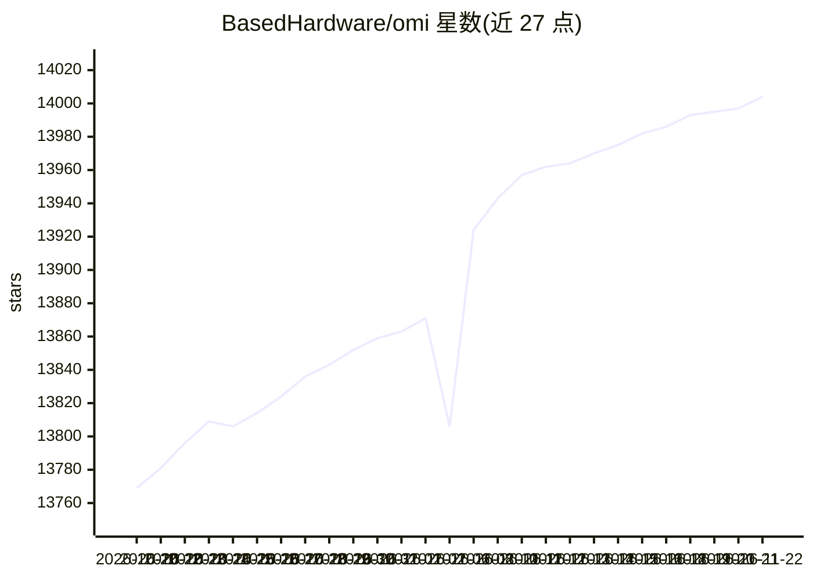

# BasedHardware/omi

⭐ 14,004 · Python · MIT · 推送 2026-11-21 · [GitHub](https://github.com/BasedHardware/omi) · [官网](https://omi.me) · 组织维护

**开源 AI 可穿戴平台：录音转写并生成记忆式对话**

开源 AI 可穿戴平台，由项链式硬件、手机/桌面应用和后端组成：采集屏幕内容与对话，实时转写并生成摘要与行动项，将内容存为可搜索、可对话的记忆。移动端为 Flutter，桌面端为 Swift/SwiftUI，后端为 Python/FastAPI/Firebase，固件与硬件设计均开源（MIT）。托管云服务与付费计划为闭源商用部分。

## 筛选速览

| 维度 | 判定 | 备注 |
|---|---|---|
| AI 角色 | `ai-native` | 本体是模型或模型工具 |
| 许可风险 | `permissive` | MIT |
| 部署形态 | `library` | 以包/库形式分发 |
| 模型依赖 | — | README 未给出锁定关系 |
| 硬件要求 | — | 无带数字的原话,不猜 |
| 安装摩擦 | `low` | 无编译、无系统依赖或容器化 |
| 成熟度 | — | 结构信号不足 |

## 动量与使用信号

- 维护:`active` — 距上次 push 0.7 天,年发版 100,366 位贡献者
- 涨星:近 1 天 **+13**(自 20261016 起算)
- 安装:npm 包 `copy` 月下载 123,782
- 平台:WINDOWS / MACOS / ANDROID / IOS · 协议:MCP

## 能力要点

- 项链式可穿戴硬件持续采集对话，固件与硬件设计开源
- 实时转写并生成摘要与行动项
- 应用、后端、固件、硬件设计均以 MIT 开源
- 提供 Developer API、MCP server、CLI 与多语言 SDK

## 适用场景

- 佩戴硬件记录对话并自动生成摘要与待办
- 与自己的历史对话记忆进行聊天检索
- 开发者基于开源硬件与应用接入自建后端

## 场景标签

`语音识别` `AI 助手` · 领域:对话与助手

## 证据(README 行号)

> L5: Omi captures your screen and conversations, transcribes in real-time, generates summaries and action items, and give
> L15: Omi is an open-source AI wearable platform: a necklace that captures conversations, apps for phone and desktop, and

## 星数曲线

2026-10-20 13,769 → 2026-11-22 14,004（+235）

---
*卡片 v1 · prompt 1.4 · 生成 2026-11-22 · 置信度 high · 依据 README sha `8d41f1b9cf4a` · [字段定义](../../DATASET.md)*
