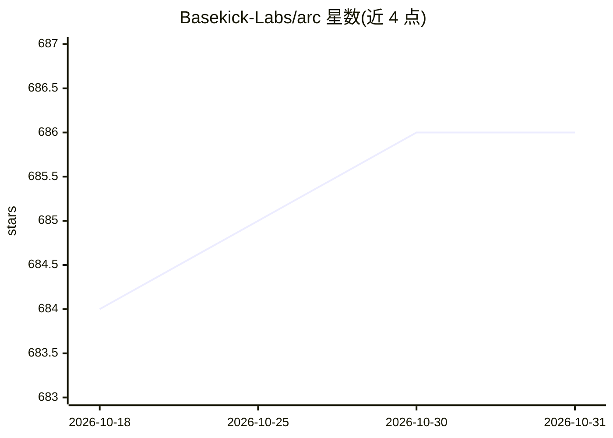

# Basekick-Labs/arc

⭐ 686 · Go · AGPL-3.0 · 推送 2026-10-30 · [GitHub](https://github.com/Basekick-Labs/arc) · [官网](https://basekick.net) · 组织维护

**SQL 时序数据库：为需长期保留的机器遥测数据提供高吞吐存取**

单一二进制部署的开源（AGPL-3.0）时序分析数据库：内置摄入管线、Parquet 存储引擎、后台压缩、SQL 查询层（以 DuckDB 为查询引擎）、保留策略与连续查询。兼容 InfluxDB Line Protocol 与 Telegraf，可直接接收现有采集层写入；数据以开放 Parquet 格式存储于本地盘、S3、Azure 或 S3 兼容对象存储。README 给出 M3 Max 笔记本上 38.1M rec/s 摄入、25.3M rows/sec 查询的基准数据。提供 Docker、Homebrew、deb/rpm、Helm 与源码构建等安装方式。

## 筛选速览

| 维度 | 判定 | 备注 |
|---|---|---|
| AI 角色 | `ai-ecosystem` | LLM/agent 周边工具 |
| 许可风险 | `dual` | AGPL-3.0 |
| 部署形态 | `desktop` | 安装包/桌面程序 |
| 模型依赖 | — | README 未给出锁定关系 |
| 硬件要求 | — | 无带数字的原话,不猜 |
| 安装摩擦 | `low` | 无编译、无系统依赖或容器化 |
| 成熟度 | — | 结构信号不足 |

## 能力要点

- 单一静态链接二进制，运行时零外部依赖，支持离线（air-gap）部署
- 兼容 InfluxDB Line Protocol 与 Telegraf，可双写渐进迁移
- 数据以开放 Parquet 格式存储在自有基础设施（本地盘/S3/Azure/MinIO 等）
- 同一查询引擎支持 JSON、MessagePack、Arrow IPC 三种线协议

## 适用场景

- 长期保留全分辨率遥测历史数据并统一 SQL 查询冷热数据
- 将现有 Telegraf/Line Protocol 采集层无改动切换到新数据库
- 在边缘设备、工厂工控机或离线环境运行时序数据库

## 场景标签

 · 领域:数据库/时序数据基础设施

## 证据(README 行号)

> L13: Open, SQL-native time-series database for telemetry you need to keep. Arc ingests 38M+ records/sec, stores data as 
> L37: Arc is a complete time-series analytical database: ingestion pipeline, Parquet storage engine, compaction system, S

## 星数曲线

2026-10-18 684 → 2026-10-31 686（+2）

---
*卡片 v1 · prompt 1.4 · 生成 2026-10-21 · 置信度 mid · 依据 README sha `5ed82cc026a1` · [字段定义](../../DATASET.md)*
