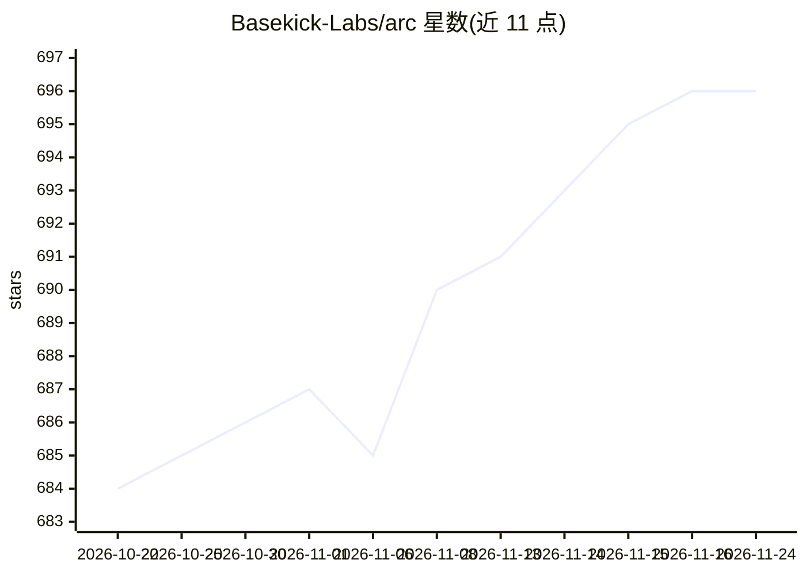

# Basekick-Labs/arc

⭐ 696 · Go · AGPL-3.0 · 推送 2026-11-24 · [GitHub](https://github.com/Basekick-Labs/arc) · [官网](https://basekick.net) · 组织维护

**SQL 时序数据库：为长期遥测数据提供高吞吐摄取与历史查询**

Arc 是一个开源 SQL 时序分析数据库，接受 InfluxDB Line Protocol 与 Telegraf 写入，数据以 Apache Parquet 存储在自有磁盘、S3、Azure 或 S3 兼容对象存储上，内部使用 DuckDB 作为查询引擎，支持窗口函数、CTE、保留策略与连续查询。以单二进制部署，Linux 仅依赖 glibc 2.34+ 与 libgcc_s，支持空气隔离环境运行。README 提供 Docker、Homebrew、deb/rpm 包安装方式。采用 AGPL-3.0 许可，组织无法接受 AGPL 时提供商业许可选项。配套 arcli 命令行与 Launchpad Web 控制台。

## 筛选速览

| 维度 | 判定 | 备注 |
|---|---|---|
| AI 角色 | `ai-enhanced` | 去掉 AI 部分产品仍成立 |
| 许可风险 | `dual` | AGPL-3.0 |
| 部署形态 | `desktop` | 安装包/桌面程序 |
| 模型依赖 | — | README 未给出锁定关系 |
| 硬件要求 | — | 无带数字的原话,不猜 |
| 安装摩擦 | `low` | 无编译、无系统依赖或容器化 |
| 成熟度 | `idea` | |

## 能力要点

- 单二进制部署，DuckDB 静态链接，无 JVM/Python/PostgreSQL 等运行时依赖
- 数据以开放 Apache Parquet 存储在本地磁盘、S3、Azure 或 S3 兼容存储
- 兼容 InfluxDB Line Protocol 与 Telegraf，支持双写迁移
- 同一查询引擎输出 Arrow IPC、MessagePack、JSON 三种线路格式，另有可选 Arrow Flight SQL 监听

## 适用场景

- 为服务器与 IoT 设备的遥测数据建立长期全分辨率历史存储
- 现有 InfluxDB/Telegraf 采集链路通过双写逐步迁移
- 边缘盒子或空气隔离环境中自托管时序分析
- 用标准 SQL 对最近与历史数据做联合分析查询

## 场景标签

 · 领域:数据库/时序分析

## 证据(README 行号)

> L15: Open, SQL-native time-series database for telemetry you need to keep. Arc ingests 38M+ records/sec, stores data as 
> L39: Arc is a complete time-series analytical database: ingestion pipeline, Parquet storage engine, compaction system, S
> L47: - **Own the files**: Arc stores data as open Apache Parquet on local disk, S3, Azure, or any S3-compatible store (S

## 星数曲线

2026-10-22 684 → 2026-11-24 696（+12）

---
*卡片 v1 · prompt 1.4 · 生成 2026-11-24 · 置信度 mid · 依据 README sha `7a7f12d8864f` · [字段定义](../../DATASET.md)*
