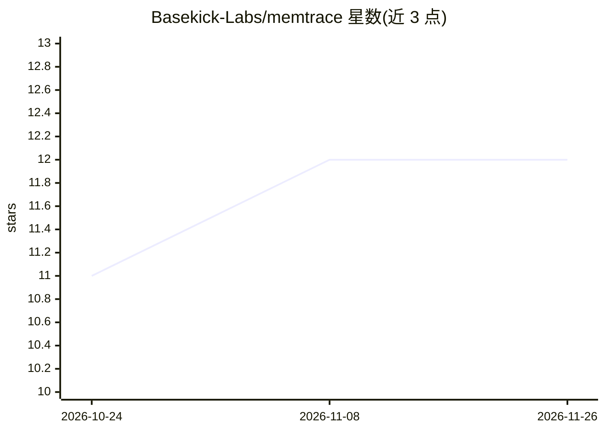

# Basekick-Labs/memtrace

⭐ 12 · Go · Apache-2.0 · 推送 2026-04-27 · [GitHub](https://github.com/Basekick-Labs/memtrace) · 组织维护

**面向生产 AI Agent 的多租户时间序列记忆层**

用 Go 编写的服务端多租户记忆层，后端为 Arc 时间序列数据库。记忆以时间序列事件存储，带类型（episodic/decision/entity/session）、标签与重要度评分，查询默认按时间窗口执行，不使用 embedding 与向量数据库。session context 端点将记忆按类型分组并输出可直接注入 prompt 的 markdown。提供 REST API、MCP server、Python/TypeScript/Go SDK 及 OpenAI Agents SDK 集成包，面向在生产环境运行多个 AI Agent 的团队。

## 筛选速览

| 维度 | 判定 | 备注 |
|---|---|---|
| AI 角色 | `ai-ecosystem` | LLM/agent 周边工具 |
| 许可风险 | `permissive` | Apache-2.0 |
| 部署形态 | `library` | 以包/库形式分发 |
| 模型依赖 | — | README 未给出锁定关系 |
| 硬件要求 | — | 无带数字的原话,不猜 |
| 安装摩擦 | `low` | 无编译、无系统依赖或容器化 |
| 成熟度 | — | 结构信号不足 |

## 能力要点

- 记忆以时间序列事件存储，时间窗口查询为一等操作，无 embedding 与向量数据库
- 多租户架构：每个组织路由到独立 Arc 实例，API key 静态加密（AES-256-GCM）
- session context 端点输出 LLM-ready markdown，可直接注入 system prompt
- 提供 MCP server（7 个工具）与 Python/TypeScript/Go 三种 SDK

## 适用场景

- 为长期运行的自主 Agent 提供跨会话持久记忆
- 呼叫中心多个 AI 客服共享同一客户记忆池
- 多 Agent 协作流水线共享决策日志
- SaaS 平台为每个客户组织分配独立记忆实例

## 场景标签

`Agent 记忆` · 领域:Agent 开发

## 证据(README 行号)

> L5: **Multi-tenant memory layer for production AI agents — backed by Arc time-series DB.** Works with ChatGPT, Claude, G
> L11: Memtrace is **server-side and multi-tenant**, built for teams running fleets of AI agents in production:
> L28: Memtrace stores memories as time-series events in Arc, a high-performance time-series database. Each memory has a t

## 星数曲线

2026-10-24 11 → 2026-11-26 12（+1）

---
*卡片 v1 · prompt 1.4 · 生成 2026-11-18 · 置信度 high · 依据 README sha `f1093701bff4` · [字段定义](../../DATASET.md)*
