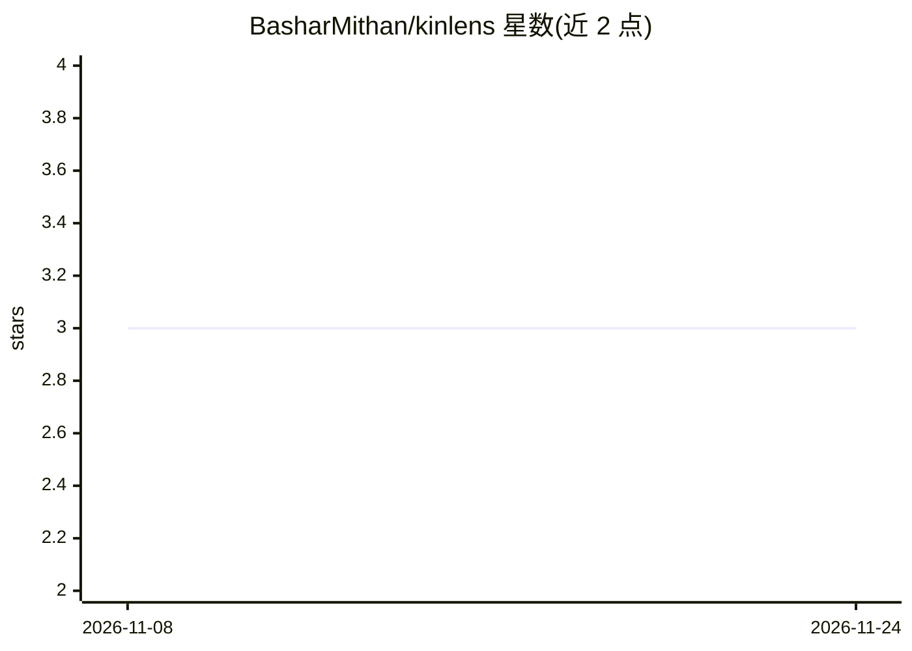

# BasharMithan/kinlens

⭐ 3 · Jupyter Notebook · Apache-2.0 · 推送 2026-11-18 · [GitHub](https://github.com/BasharMithan/kinlens) · 个人维护

**教学用可解释 KNN 分类器：每次预测附带证据**

教育性质的 Python/NumPy 项目，从零实现面向对象的 K 近邻分类器：读取 CSV 标注数据，经数据构建、暴力搜索、距离度量（欧氏/曼哈顿/余弦）、投票（uniform/逆距离）到分类，各环节以接口分离便于理解与扩展。每次预测返回 Explanation 对象，记录邻居、距离、权重、各类得分与置信度。限制：无 predict_proba、特征缩放、评估工具，置信度非校准概率；需 Python 3.14+ 与 uv；提供与 scikit-learn 的可复现基准笔记本。

## 筛选速览

| 维度 | 判定 | 备注 |
|---|---|---|
| AI 角色 | `ai-native` | 本体是模型或模型工具 |
| 许可风险 | `permissive` | Apache-2.0 |
| 部署形态 | `None` |  |
| 模型依赖 | — | README 未给出锁定关系 |
| 硬件要求 | — | 无带数字的原话,不猜 |
| 安装摩擦 | `low` | 无编译、无系统依赖或容器化 |
| 成熟度 | — | 结构信号不足 |

## 能力要点

- 每次预测附带证据：邻居索引、距离、权重与各类得分
- 数据/搜索/度量/投票/分类组件接口化分离
- 内置欧氏、曼哈顿、余弦距离与两种投票策略
- 与 scikit-learn KNN 在同一数据集上的可复现基准

## 适用场景

- 学习 KNN 算法内部机制并逐组件扩展
- 课堂教学中展示可解释的分类预测证据
- 复现与 scikit-learn 的对比基准实验

## 场景标签

`教程课程` · 领域:学习与行业

## 证据(README 行号)

> L9: Kinlens is an educational Python project for exploring an explainable
> L47: - **Explanation:** `Explanation` records

## 星数曲线

2026-11-08 3 → 2026-11-24 3（+0）

---
*卡片 v1 · prompt 1.4 · 生成 2026-11-22 · 置信度 high · 依据 README sha `a08eb1df353a` · [字段定义](../../DATASET.md)*
