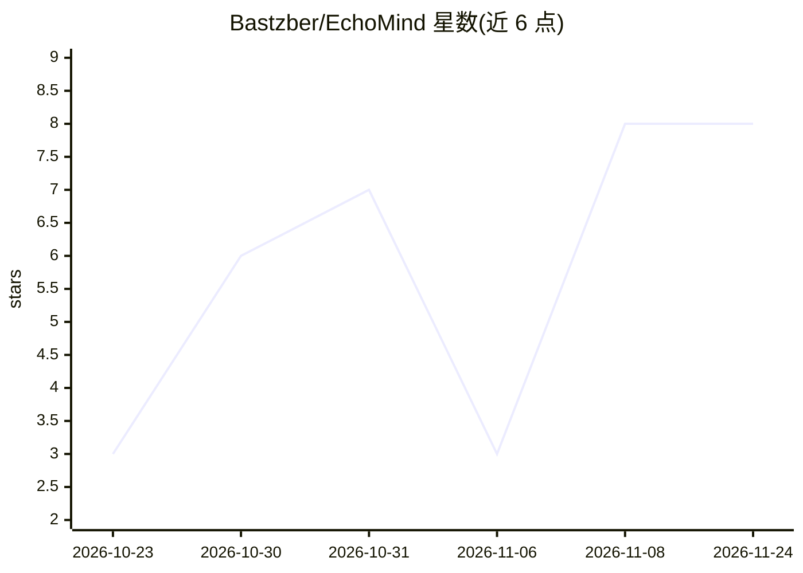

# Bastzber/EchoMind

⭐ 8 · Python · GPL-3.0 · 推送 2026-11-12 · [GitHub](https://github.com/Bastzber/EchoMind) · 个人维护 · 中文 README

**给音效创作者：一句话语义检索本地音效库并生成新音效**

基于 SoundBot 二次开发的中文本地化桌面音效管理器，Electron 界面加 PyInstaller 冻结的 FastAPI/SQLite/Chroma 本地后端。用 CLAP 音频编码与文本元数据双索引实现语义搜索，权重为音频 0.55、文本 0.30、关键词 0.15；支持导入、波形、标签、项目隔离、LLM 生成一句话描述与语音合成创造音效、Demucs 分轨。安装包内置 CLAP、Breeze、Demucs 模型，Windows/macOS ARM64 提供 6GB 级网盘安装包，源码构建需 Python 3.12 与 Node.js 20。

## 筛选速览

| 维度 | 判定 | 备注 |
|---|---|---|
| AI 角色 | `ai-native` | 本体是模型或模型工具 |
| 许可风险 | `viral` | GPL-3.0 |
| 部署形态 | `desktop` | 安装包/桌面程序 |
| 模型依赖 | local-ok | 支持本地模型 |
| 硬件要求 | — | 无带数字的原话,不猜 |
| 安装摩擦 | `medium` | 含编译或系统依赖之一 |
| 成熟度 | `idea` | |

## 能力要点

- CLAP 音频 + 文本元数据双索引混合搜索，权重可诊断
- LLM 批量生成中文一句话描述并可导出描述包跨机复用
- AI 分轨拆人声/鼓/贝斯/其他四轨，去人声生成伴奏
- 本地语音引擎 Breeze 离线合成 AI 助手回复

## 适用场景

- 在本地音效库里用一句话中文描述找声音
- 为素材库批量补描述、跨机器迁移描述包
- 把音乐拆轨或消除人声做素材再利用

## 场景标签

`语音合成` `语义搜索` · 领域:内容生成

## 证据(README 行号)

> L12: > 一句话描述你要的声音：**库里有，0.3 秒找出来；库里没有，当场生成一个。**
> L95: |双索引|原始声音使用 CLAP 音频编码；文件名、逻辑目录、标签、UCS 分类与描述进入独立文本元数据索引|
> L98: |AI 助手|支持本地或 OpenAI-compatible LLM；AI 不可用时直接用原始查询执行本地搜索|

## 星数曲线

2026-10-23 3 → 2026-11-24 8（+5）

---
*卡片 v1 · prompt 1.4 · 生成 2026-11-20 · 置信度 high · 依据 README sha `0977a8efa7f4` · [字段定义](../../DATASET.md)*
