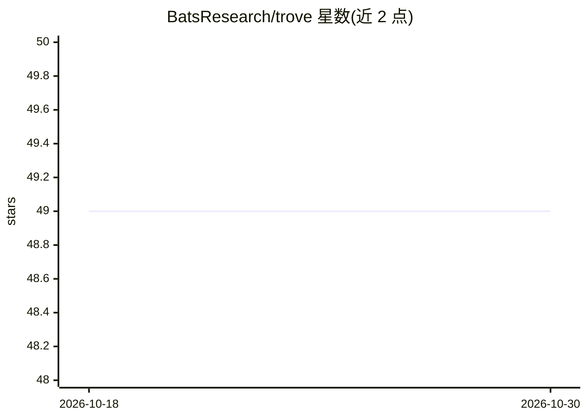

# BatsResearch/trove

⭐ 49 · Python · Apache-2.0 · 推送 2025-11-12 · [GitHub](https://github.com/BatsResearch/trove) · [官网](https://ir-trove.dev) · 组织维护

**训练与评测 transformer 稠密检索器的工具包**

面向研究者的稠密检索工具包：提供双编码器检索器的训练、IR 指标评测与难负例挖掘的最小一致接口，支持二值与多级相关性标签。数据操作层可在运行时合并多个数据源并重标注签，支持合成多级排序上下文的训练流程。基于 Hugging Face transformers 生态构建，兼容 PEFT 方法，支持 accelerate 多 GPU/多节点训练与 deepspeed。以 PyPI 包 ir-trove 或源码安装。

## 筛选速览

| 维度 | 判定 | 备注 |
|---|---|---|
| AI 角色 | `ai-ecosystem` | LLM/agent 周边工具 |
| 许可风险 | `permissive` | Apache-2.0 |
| 部署形态 | `library` | 以包/库形式分发 |
| 模型依赖 | — | README 未给出锁定关系 |
| 硬件要求 | — | 无带数字的原话,不猜 |
| 安装摩擦 | `low` | 无编译、无系统依赖或容器化 |
| 成熟度 | — | 结构信号不足 |

## 能力要点

- 双编码器检索器训练与 IR 指标评测的统一接口
- 难负例挖掘仅需改动少量代码
- 多数据源运行时合并与标签重分配
- 支持多 GPU/多节点训练与 deepspeed

## 适用场景

- 快速实验新的稠密检索方法
- 用合成多级标注数据训练检索器
- 为查询挖掘难负例以改进训练效果

## 场景标签

`模型评测` `微调` `语义搜索` · 领域:评测与运维

## 证据(README 行号)

> L7: Trove is a lightweight toolkit for training and evaluating transformer-based dense retrievers.
> L15: - Built to work seamlessly with the Hugging Face ecosystem (e.g., PEFT methods, distributed training/inference)

## 星数曲线

2026-10-18 49 → 2026-10-30 49（+0）

---
*卡片 v1 · prompt 1.4 · 生成 2026-10-25 · 置信度 high · 依据 README sha `51220de60a90` · [字段定义](../../DATASET.md)*
