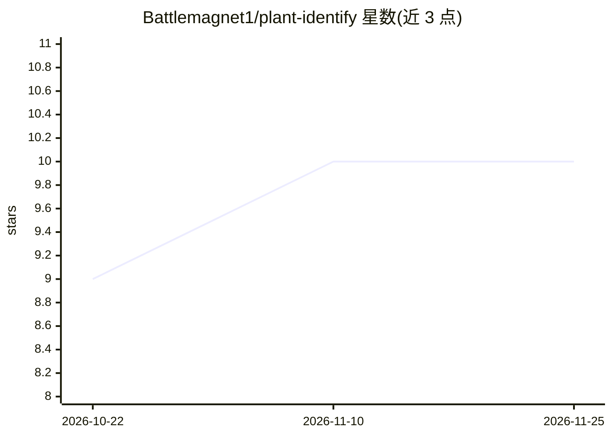

# Battlemagnet1/plant-identify

⭐ 10 · Kotlin · MIT · 推送 2026-10-20 · [GitHub](https://github.com/Battlemagnet1/plant-identify) · 个人维护 · 中文 README

**给园林学习者与从业者的多图 AI 植物识别与本地档案应用**

Android 端植物识别与数字档案应用：一次上传 1-5 张同一株植物照片（整株/叶片/花/果实/树皮），由视觉模型联合判断而非逐图投票。识别走视觉 AI 与 Pl@ntNet 两条通道，可开启双源定性比对。数据全部存本机，无后端，API Key 由用户自填并用 Android Keystore AES-256-GCM 加密。提供基础版与完整版两个 APK，完整版含识别任务队列、数据清洗去重、景观多样性分析与备份导出。需 Android 8.0+，装后必须配置 AI 服务才能识别。

## 筛选速览

| 维度 | 判定 | 备注 |
|---|---|---|
| AI 角色 | `ai-native` | 本体是模型或模型工具 |
| 许可风险 | `permissive` | MIT |
| 部署形态 | `None` |  |
| 模型依赖 | — | README 未给出锁定关系 |
| 硬件要求 | — | 无带数字的原话,不猜 |
| 安装摩擦 | `medium` | 含编译或系统依赖之一 |
| 成熟度 | — | 结构信号不足 |

## 能力要点

- 1-5 张同株照片多图联合识别，而非逐图投票
- 视觉 AI 与 Pl@ntNet 双通道，支持定性双源比对
- API Key 经 Android Keystore AES-256-GCM 加密本地存放，无统计/上报 SDK
- 完整版含后台识别任务队列、六级去重与 AI 复核、HTML 导出与 zip 备份

## 适用场景

- 野外或校园调查时拍照识别植物并建立个人数字档案
- 批量照片丢进队列后台识别，整理植物观察记录
- 导出 HTML 报告或 zip 备份，与他人交换植物档案

## 场景标签

`目标检测` · 领域:感知与多模态

## 证据(README 行号)

> L3: **English** · An Android app for **AI multi-image plant identification** and personal
> L14: 核心特色是**多图联合识别**：一次上传 1–5 张同一株植物的照片（整株 / 叶片 / 花 / 果实 / 树皮），由视觉模型综合所有视觉证据进行判断，而非对每张图独立识别后投票。
> L12: 面向园林专业学生、园林园艺从业者、植物学学习者与植物调查人员的 **AI 多图植物识别 + 植物数字档案** Android 应用。

## 星数曲线

2026-10-22 9 → 2026-11-25 10（+1）

---
*卡片 v1 · prompt 1.4 · 生成 2026-11-20 · 置信度 high · 依据 README sha `cae9fee2f07c` · [字段定义](../../DATASET.md)*
