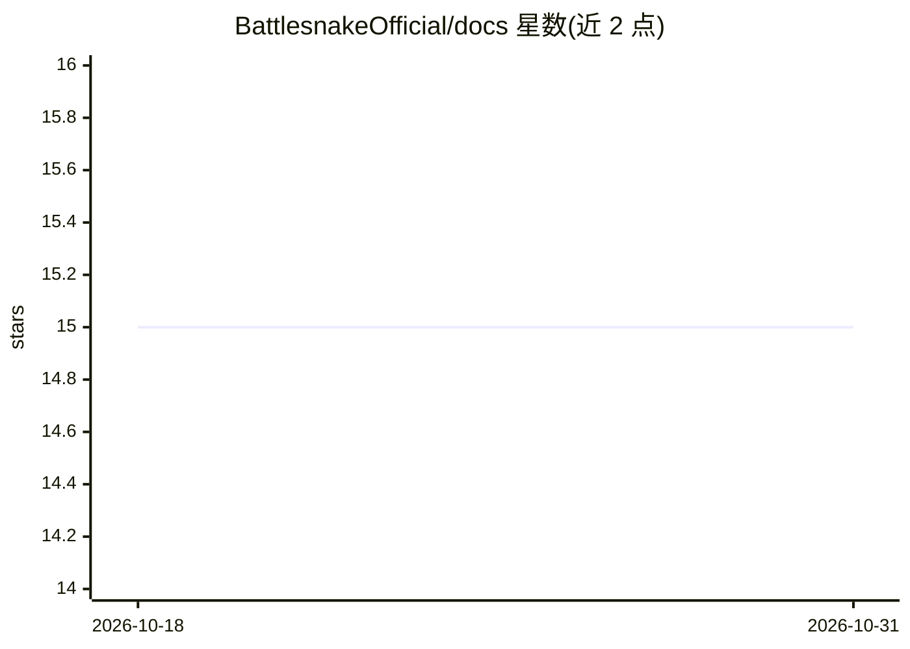

# BattlesnakeOfficial/docs

⭐ 15 · JavaScript · MIT · 推送 2026-09-28 · [GitHub](https://github.com/BattlesnakeOfficial/docs) · [官网](https://docs.battlesnake.com) · 组织维护

**Battlesnake 编程游戏的官方文档仓库（社区共建重写版）**

Battlesnake 官方文档的重写版本仓库，内容由社区维护，目标是在旧文档基础上改进并提供更多有用内容。仓库本身基于 Docusaurus 构建：需要 Node.js 18 与 npm，npm install 安装依赖，npm start 启动本地开发服务器实时预览，npm run build 生成静态页面可部署到任意静态托管服务。文档面向 Battlesnake 参与者与贡献者，接受通过 PR 的社区贡献。

## 筛选速览

| 维度 | 判定 | 备注 |
|---|---|---|
| AI 角色 | `ai-knowledge` | 知识聚合/清单类 |
| 许可风险 | `permissive` | MIT |
| 部署形态 | `library` | 以包/库形式分发 |
| 模型依赖 | — | README 未给出锁定关系 |
| 硬件要求 | — | 无带数字的原话,不猜 |
| 安装摩擦 | `low` | 无编译、无系统依赖或容器化 |
| 成熟度 | — | 结构信号不足 |

## 能力要点

- Battlesnake 官方文档的社区重写版本
- 基于 Docusaurus 构建，支持本地实时预览开发
- npm run build 生成可静态托管的文档站点

## 适用场景

- 查阅 Battlesnake 编程游戏的规则与开发指南
- 通过 PR 参与官方文档的改进与翻译
- 本地搭建文档站点预览修改效果

## 场景标签

 · 领域:游戏开发文档

## 证据(README 行号)

> L3: This repository contains a rewrite of all
> L4: documentation for Battlesnake,

## 星数曲线

2026-10-18 15 → 2026-10-31 15（+0）

---
*卡片 v1 · prompt 1.4 · 生成 2026-10-31 · 置信度 high · 依据 README sha `7a7cbfe2dbca` · [字段定义](../../DATASET.md)*
