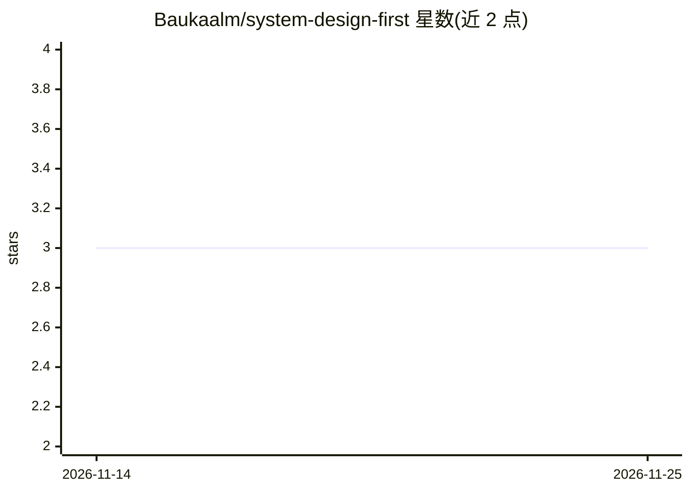

# Baukaalm/system-design-first

⭐ 3 · HTML · MIT · 推送 2026-11-05 · [GitHub](https://github.com/Baukaalm/system-design-first) · 个人维护

**让编码 Agent 在写代码前先做系统设计走查的技能包**

以 Agent Skills 格式发布的单一技能：安装后编码 Agent 在实现功能前按比例执行设计走查——判断任务深度（L0 改动到 L3 子系统）、估算 QPS 与存储增长、读取现有代码映射 as-is 架构、提出 to-be 方案并记录每个模式的取舍理由，按需输出终端图示或含 Mermaid 与 architecture.html 的设计文件夹。提供 npx 安装器、Claude Code 插件市场、git clone 脚本与手工放置多种安装方式；作者自述在 evals/ 下含 1.5× token 开销。

## 筛选速览

| 维度 | 判定 | 备注 |
|---|---|---|
| AI 角色 | `ai-ecosystem` | LLM/agent 周边工具 |
| 许可风险 | `permissive` | MIT |
| 部署形态 | `library` | 以包/库形式分发 |
| 模型依赖 | locked-api |  |
| 硬件要求 | — | 无带数字的原话,不猜 |
| 安装摩擦 | `low` | 无编译、无系统依赖或容器化 |
| 成熟度 | — | 结构信号不足 |

## 能力要点

- 深度分级（L0-L3）按任务规模调整设计输出，避免小改动产出冗长设计
- 负载估算数字用于否决模式，每个模式附被拒替代方案
- 按需生成 as-is vs to-be 架构图：终端图、Mermaid 或离线单文件 architecture.html
- 多目标支持：Claude Code、Codex、Cursor、Copilot、Gemini CLI 等

## 适用场景

- 让 Agent 在实现新功能前先给出规模估算与架构方案
- 在改代码前让 Agent 解释现有系统的工作方式
- 对已有服务做扩容前的设计评估

## 场景标签

`编码 Agent` · 领域:编码与开发

## 证据(README 行号)

> L18: Works with Claude Code, Codex, Cursor, Copilot, Gemini CLI and any agent that
> L150: |`SKILL.md`|The workflow, the depth gauge and the judgment rules (numbers before patterns, respect the author, rea
> L22: npx skills add Baukaalm/system-design-first

## 星数曲线

2026-11-14 3 → 2026-11-25 3（+0）

---
*卡片 v1 · prompt 1.4 · 生成 2026-11-22 · 置信度 mid · 依据 README sha `57b629570a8a` · [字段定义](../../DATASET.md)*
