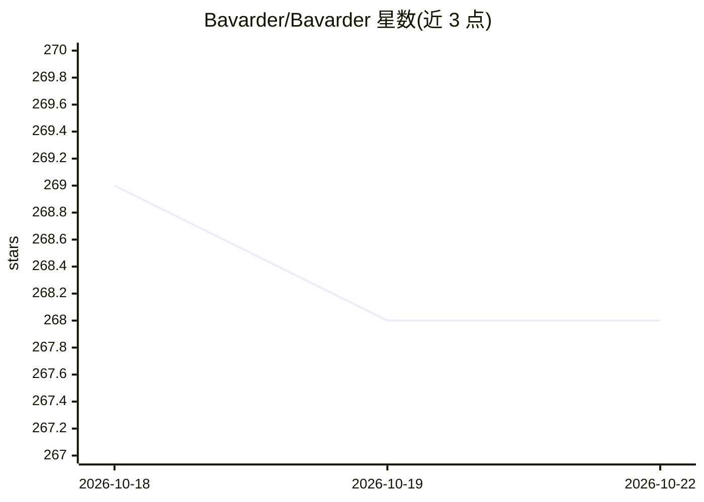

# Bavarder/Bavarder

⭐ 268 · Python · GPL-3.0 · 推送 2026-09-10 · [GitHub](https://github.com/Bavarder/Bavarder) · [官网](https://bavarder.github.io/) · 组织维护

**GNOME/Linux 桌面 AI 聊天应用，本地优先**

面向 Linux 桌面用户的 AI 对话应用，基于 GNOME/libadwaita 构建，定位为本地优先（local-first）的 chit-chat 工具，仓库主题标签涉及 Gemma、Qwen、LiteRT-LM 等本地模型生态。安装途径包括 Flathub Flatpak、Snap、Nix flake（可 nix run 免安装运行）以及 flatpak-builder/Meson 源码构建，支持通过 GNOME Software 搜索安装。项目在 GitHub/GitLab/Codeberg 提供多镜像，并开放 Codeberg Translate 翻译参与。

## 筛选速览

| 维度 | 判定 | 备注 |
|---|---|---|
| AI 角色 | `ai-native` | 本体是模型或模型工具 |
| 许可风险 | `viral` | GPL-3.0 |
| 部署形态 | `None` |  |
| 模型依赖 | — | README 未给出锁定关系 |
| 硬件要求 | — | 无带数字的原话,不猜 |
| 安装摩擦 | `low` | 无编译、无系统依赖或容器化 |
| 成熟度 | — | 结构信号不足 |

## 能力要点

- GNOME/libadwaita 原生桌面 AI 聊天应用
- Flathub、Snap、Nix flake 多渠道分发
- 主题标签显示涉及 Gemma/Qwen/LiteRT-LM 本地模型生态

## 适用场景

- 在 Linux 桌面上与 AI 进行日常对话
- 通过 Flatpak 或 Nix 快速安装/免安装试用

## 场景标签

`聊天机器人` · 领域:对话与助手

## 证据(README 行号)

> L7:  Chit-chat with an AI
> L11:  <a href="https://flathub.org/apps/details/io.github.Bavarder.Bavarder">

## 星数曲线

2026-10-18 269 → 2026-10-22 268（-1）

---
*卡片 v1 · prompt 1.4 · 生成 2026-10-22 · 置信度 mid · 依据 README sha `72a86e4e5f5e` · [字段定义](../../DATASET.md)*
