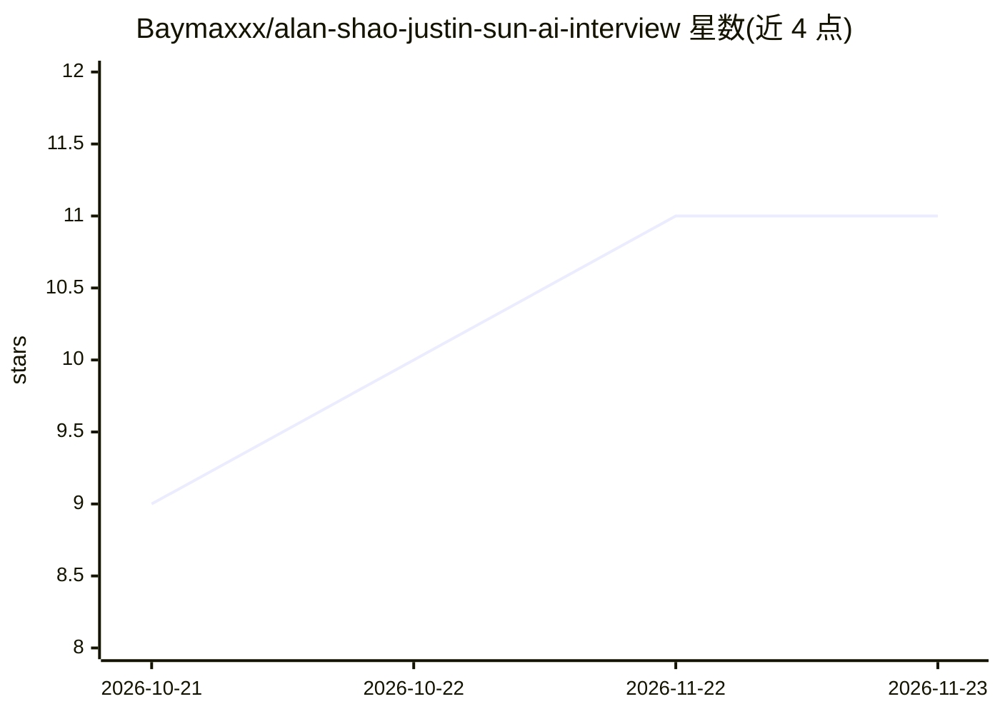

# Baymaxxx/alan-shao-justin-sun-ai-interview

⭐ 11 · NOASSERTION · 推送 2026-10-11 · [GitHub](https://github.com/Baymaxxx/alan-shao-justin-sun-ai-interview) · 个人维护 · 中文 README

**邵艾伦与孙宇晨四小时 AI 对话的逐字稿与观点整理合集**

收录一场关于 AI、认知与个人成长的长对话（4 小时 22 分）：两版带时间戳的全文逐字稿（修订整理版与 AI 转录版）、一份 PDF、15 个核心观点摘要及 15 篇整理者编写的配套实践指南。仓库同时提供 AI 学习提示词供读者结合自身情况使用。收录方声明未逐句核对音频，修订版非严格逐字记录，引用需按时间戳回看原视频核对。

## 筛选速览

| 维度 | 判定 | 备注 |
|---|---|---|
| AI 角色 | `ai-knowledge` | 知识聚合/清单类 |
| 许可风险 | `none` | NOASSERTION |
| 部署形态 | `None` |  |
| 模型依赖 | — | README 未给出锁定关系 |
| 硬件要求 | — | 无带数字的原话,不猜 |
| 安装摩擦 | `low` | 无编译、无系统依赖或容器化 |
| 成熟度 | — | 结构信号不足 |

## 能力要点

- 两版带时间戳全文：修订整理版与 AI 转录版可对照阅读
- 15 个核心观点，每条附视频时间戳
- 15 篇整理者编写的配套实践指南与 AI 学习提示词
- 提供 PDF 下载与仓库 ZIP / git clone 保存方式

## 适用场景

- 想了解这场 AI 时代机会对话的内容要点
- 按时间戳回看原视频前先检索具体话题
- 借助配套指南把对话观点落到自己的具体问题

## 场景标签

 · 领域:知识/内容聚合

## 证据(README 行号)

> L6:  两版带时间戳的全文、一份 PDF、15 个核心观点，以及配套实践指南。
> L35: |修订整理版|作者称修正了人名、术语，并清理部分口语重复；正文仍可能存在错误。|阅读全文|
> L42: 从 准备说明 开始，再挑与你当前问题有关的一篇。以下指南是整理者编写的实践材料，不是访谈逐字原话。

## 星数曲线

2026-10-21 9 → 2026-11-23 11（+2）

---
*卡片 v1 · prompt 1.4 · 生成 2026-11-20 · 置信度 high · 依据 README sha `2acbe8fd0758` · [字段定义](../../DATASET.md)*
