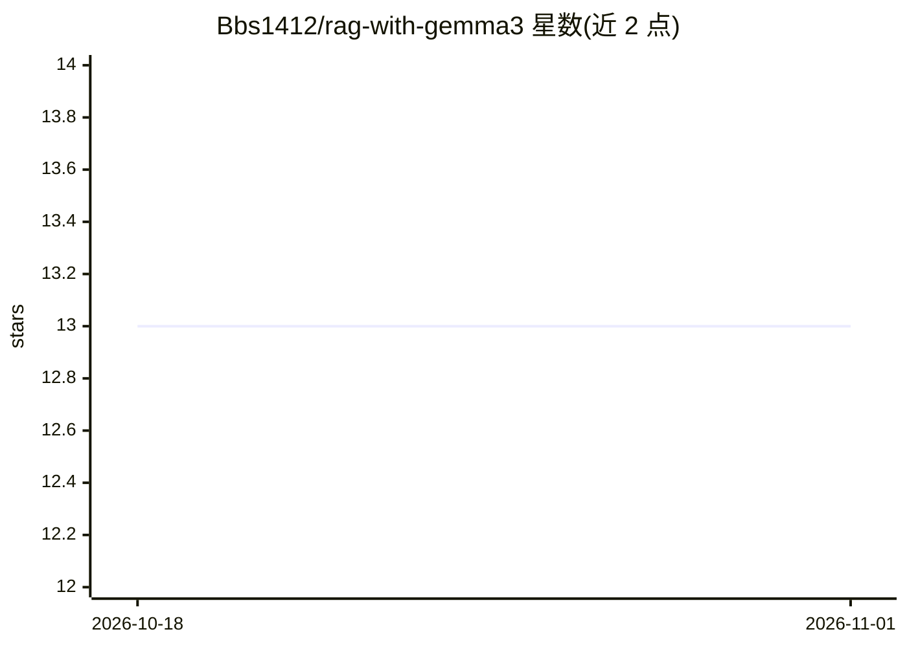

# Bbs1412/rag-with-gemma3

⭐ 13 · Python · GPL-3.0 · 推送 2026-05-22 · [GitHub](https://github.com/Bbs1412/rag-with-gemma3) · [官网](https://huggingface.co/spaces/bhushan-songire/rag-with-gemma3) · 个人维护

**基于 Gemma 3 + Ollama 本地推理的模块化 RAG 文档问答系统**

端到端检索增强生成（RAG）应用：用户上传 PDF/TXT/Markdown 等文档，通过自然语言与文档内容对话，全流程本地化处理。技术栈为 Streamlit 前端、FastAPI 后端（SSE 流式响应）、LangChain 编排、FAISS 向量存储、SQLite-3 用户认证与数据管理；LLM 通过 Ollama 本地运行 Gemma-3，嵌入用 mxbai-embed-large。支持多用户、多文件嵌入、公共文档、会话历史摘要与文件预览。提供虚拟环境与 Docker（单容器/Compose 多容器）两种运行方式；Hugging Face 部署版因托管限制改用 Gemini-2.0-Flash-Lite。

## 筛选速览

| 维度 | 判定 | 备注 |
|---|---|---|
| AI 角色 | `ai-native` | 本体是模型或模型工具 |
| 许可风险 | `viral` | GPL-3.0 |
| 部署形态 | `self-host` | docker 或自建部署 |
| 模型依赖 | local-ok | 支持本地模型 |
| 硬件要求 | — | 无带数字的原话,不猜 |
| 安装摩擦 | `low` | 无编译、无系统依赖或容器化 |
| 成熟度 | — | 结构信号不足 |

## 能力要点

- 文件摄取、嵌入、检索、上下文生成、SSE 流式回复的完整 RAG 流水线
- Ollama 本地运行 Gemma-3 与 mxbai-embed-large，数据不出本机
- SQLite-3 + bcrypt 的多用户认证与按用户的文档/向量隔离管理
- 单容器与 Docker Compose 双部署模式，支持 LangSmith 追踪（可选）

## 适用场景

- 上传个人文档并本地私密度地与其对话问答
- 团队内共享公共手册/规则书供多用户检索问答
- 学习或演示模块化 RAG 系统的完整工程实现

## 场景标签

`文档问答` `RAG` · 领域:知识与检索

## 证据(README 行号)

> L3: This project is a **modular Retrieval-Augmented Generation (RAG) system** built with Google DeepMind's - **Gemma 3**
> L5: Designed with modularity and performance in mind, the system handles end-to-end workflows including file ingestion, 

## 星数曲线

2026-10-18 13 → 2026-11-01 13（+0）

---
*卡片 v1 · prompt 1.4 · 生成 2026-10-31 · 置信度 high · 依据 README sha `e59294eb5733` · [字段定义](../../DATASET.md)*
