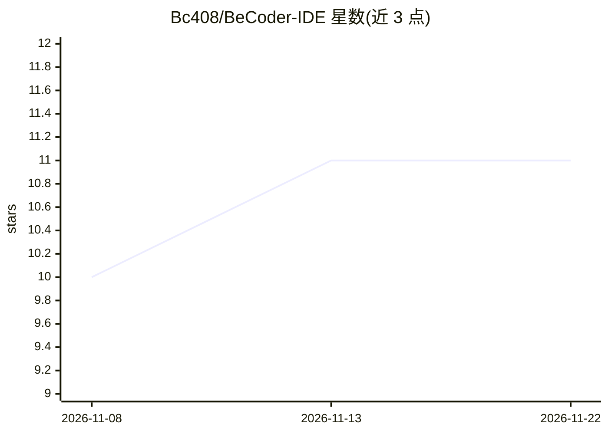

# Bc408/BeCoder-IDE

⭐ 11 · TypeScript · GPL-3.0 · 推送 2026-11-21 · [GitHub](https://github.com/Bc408/BeCoder-IDE) · [官网](https://ide.becoder.tech/) · 个人维护 · 中文 README

**面向 OI/ICPC 的 Windows C/C++ 竞赛编程编辑器**

基于 Code - OSS 1.140.0 构建的 64 位 Windows 竞赛编程环境，将编辑器、GCC 编译器、clangd、样例评测与题面阅读整合为一体，安装后即可编写和运行 C/C++（默认 C17/C++20）。提供 CPH 样例管理、批量运行与输出对比、内置浏览器导入 OJ 题目、离线 PDF 阅读与 Markdown 笔记。可选 AI 助手 Beacon 接入 DeepSeek 等模型服务，用于讲题与代码分析，但需自行配置模型服务，编辑、编译和样例测试无需配置 AI。

## 筛选速览

| 维度 | 判定 | 备注 |
|---|---|---|
| AI 角色 | `ai-enhanced` | 去掉 AI 部分产品仍成立 |
| 许可风险 | `viral` | GPL-3.0 |
| 部署形态 | `None` |  |
| 模型依赖 | local-ok | 支持本地模型 |
| 硬件要求 | — | 无带数字的原话,不猜 |
| 安装摩擦 | `medium` | 含编译或系统依赖之一 |
| 成熟度 | — | 结构信号不足 |

## 能力要点

- 内置 GCC 16.2.0 与 clangd，安装即可编译运行 C/C++
- CPH 样例管理、批量运行与输出对比，从 OJ 页面导入题目与样例
- 可选 Beacon 助手接入多家模型服务，支持流式回答、图片输入与可控联网
- 提供 Setup 应用版与 Portable 版两种安装模式，均含工具链

## 适用场景

- OI/ICPC 选手在本地完成写题、编译与样例验证
- 从 OJ 网页导入题目样例，离线调试后回站提交
- 用 AI 助手讲题、分析代码并整理学习笔记

## 场景标签

 · 领域:开发工具/教育竞赛

## 证据(README 行号)

> L11: BeCoder 将编辑器、编译器、代码智能、样例评测和题面阅读整合在一起。安装后即可编写和运行 C/C++；可选的 AI 助手 Beacon 用于讲题、分析代码和整理学习笔记。
> L21: |Beacon|接入 DeepSeek、阿里云百炼、月之暗面与 Ollama，支持流式回答、公式、图片输入和可控的文件访问与联网|
> L24: Beacon 需要自行配置模型服务；模型与网络能力取决于服务商。编辑、编译和样例测试无需配置 AI。完整能力与当前限制见使用指南和 Beacon 说明。

## 星数曲线

2026-11-08 10 → 2026-11-22 11（+1）

---
*卡片 v1 · prompt 1.4 · 生成 2026-11-19 · 置信度 high · 依据 README sha `3fc1586ea32d` · [字段定义](../../DATASET.md)*
