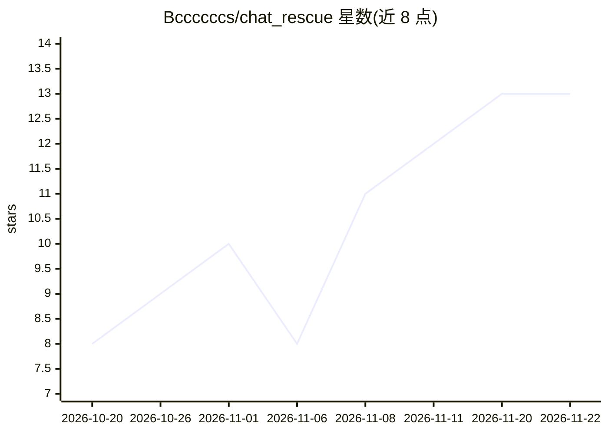

# Bccccccs/chat_rescue

⭐ 13 · Python · MIT · 推送 2026-11-09 · [GitHub](https://github.com/Bccccccs/chat_rescue) · 个人维护 · 中文 README

**误删微信单聊的 Mac/Windows 离线恢复工具，支持 AI agent 代跑**

面向误删微信单聊的用户：在双方授权下读取保留方（B）的本地数据库，转换为误删方（A）的收发视角，生成可核对的恢复候选，经备份、预览确认后应用。提供 Mac Apple Silicon 与 Windows x64 桌面向导及 CLI，内置 Python 与 SQLCipher；支持文本/名片/文件消息，语音图片视频附件需开启实验模式。所有版本均为实验预发布，手机迁移不自动同步，需本人手动迁移并验收。README 另提供 AGENTS.md 提示词，可交给具备本机文件与终端权限的 AI agent 按流程代为执行。

## 筛选速览

| 维度 | 判定 | 备注 |
|---|---|---|
| AI 角色 | `ai-enhanced` | 去掉 AI 部分产品仍成立 |
| 许可风险 | `permissive` | MIT |
| 部署形态 | `desktop` | 安装包/桌面程序 |
| 模型依赖 | — | README 未给出锁定关系 |
| 硬件要求 | — | 无带数字的原话,不猜 |
| 安装摩擦 | `low` | 无编译、无系统依赖或容器化 |
| 成熟度 | `idea` | |

## 能力要点

- 从对方保留记录恢复自己视角，含收发方向转换与消息编号核对
- 提供桌面向导与 CLI 双路径，内置 Python、SQLCipher 与离线文档
- 应用前生成预览、备份原件，支持撤回保护与部分失败回执
- 附 AGENTS.md 执行提示词，可交由本机 AI agent 按教程协助运行

## 适用场景

- 误删了与某人的微信单聊，对方手机/电脑上仍有完整记录
- 恢复语音、图片、视频等媒体内容（开启实验模式）
- 不会命令行时让 AI agent 按教程代为执行恢复流程

## 场景标签

 · 领域:数据恢复/桌面工具

## 证据(README 行号)

> L118: ## 让 agent 帮你运行
> L120: **你可以把整个项目交给具备本机文件访问和终端执行能力的 AI agent，让它按教程帮你运行；你主要按照它的提示完成必要的人工作业。** 下载或克隆仓库，在 agent 中打开项目文件夹，然后发送：

## 星数曲线

2026-10-20 8 → 2026-11-22 13（+5）

---
*卡片 v1 · prompt 1.4 · 生成 2026-11-18 · 置信度 mid · 依据 README sha `4c76dd4dca99` · [字段定义](../../DATASET.md)*
