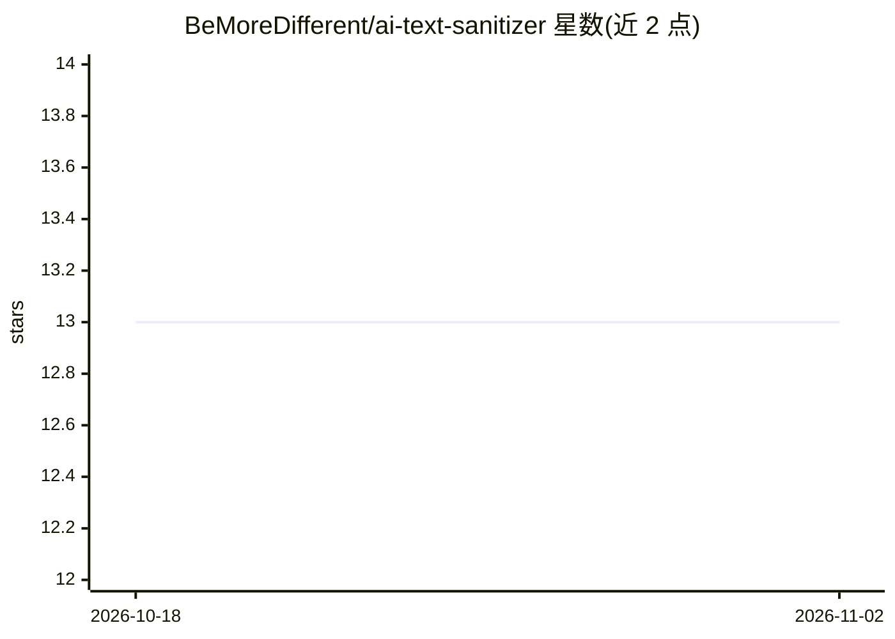

# BeMoreDifferent/ai-text-sanitizer

⭐ 13 · TypeScript · MIT · 推送 2026-04-09 · [GitHub](https://github.com/BeMoreDifferent/ai-text-sanitizer) · [官网](https://bemoredifferent.github.io/ai-text-sanitizer/) · 个人维护

**清理与规范化 LLM 生成文本的零依赖 ES 模块库**

用于对大语言模型生成的原始文本做后处理的 TypeScript/ES 模块库：移除不可见 Unicode 字符、确定性水印痕迹、可见的模型/来源标注残留、奇异空白与 ASCII 控制符，转换花式标点为 ASCII，剥离内联引用占位符，并返回逐规则变更统计供审计。附三种水印检测器（heuristic/synthid/soft-watermark）、可选重写策略（light/aggressive）与 npx CLI，支持 --strict 作为 CI 门禁。明确声明不解析 HTML 结构、不承诺规避 token 统计类水印检测。面向开发者，要求 Node ≥ 18，通过 pnpm/npm 安装。

## 筛选速览

| 维度 | 判定 | 备注 |
|---|---|---|
| AI 角色 | `ai-ecosystem` | LLM/agent 周边工具 |
| 许可风险 | `permissive` | MIT |
| 部署形态 | `library` | 以包/库形式分发 |
| 模型依赖 | — | README 未给出锁定关系 |
| 硬件要求 | — | 无带数字的原话,不猜 |
| 安装摩擦 | `low` | 无编译、无系统依赖或容器化 |
| 成熟度 | — | 结构信号不足 |

## 能力要点

- 移除零宽字符、Unicode tag 载荷、可见模型标注残留等多类隐藏文本通道
- 逐规则变更统计（removedTags/removedVariationSelectors 等）供审计
- 三种水印检测器（heuristic / SynthID 兼容 / soft-watermark），检测不改写文本
- 提供 CLI 与 --strict 退出码作为 CI 门禁

## 适用场景

- 渲染、存储或 diff 前清洗 LLM 输出中的隐藏水印与传输痕迹
- 在 CI 中拦截含未授权 Unicode 标记的合并请求
- 记录并序列化水印检测结果供审计

## 场景标签

 · 领域:LLM 文本后处理工具库

## 证据(README 行号)

> L11: ai-text-sanitizer is a tiny zero-dependency ES module for cleaning and normalising raw text generated by large lang
> L15: The library removes invisible Unicode watermark characters, Unicode tag payloads, supplementary variation selectors

## 星数曲线

2026-10-18 13 → 2026-11-02 13（+0）

---
*卡片 v1 · prompt 1.4 · 生成 2026-10-31 · 置信度 high · 依据 README sha `f74292413ab9` · [字段定义](../../DATASET.md)*
