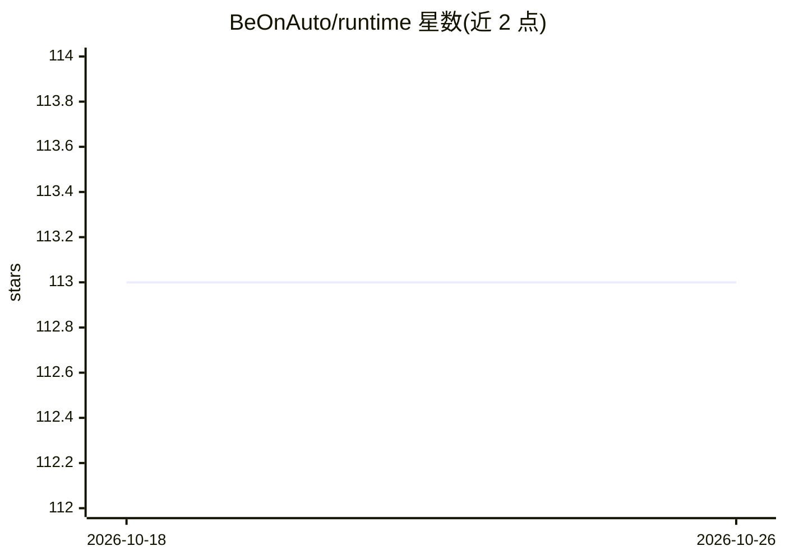

# BeOnAuto/runtime

⭐ 113 · TypeScript · NOASSERTION · 推送 2026-10-25 · [GitHub](https://github.com/BeOnAuto/runtime) · [官网](https://on.auto) · 组织维护

**自托管的业务自动化 playbook 运行时，全程记录账本**

执行由 agent 构建的 playbook 的运行时：playbook 由 brain（函数集合）与协调函数的 workflows 组成，每次函数或 workflow 调用产生带结果与所用版本的 run，统一记入 ledger；Connections 提供外部服务的授权访问。配套 Auto Studio 用于查看与管理。以 npx 启动本地模式（localhost:5555，无登录），也可通过 Docker 镜像或自托管部署；需 Node.js 26.10+，仅支持 macOS/Linux。Elastic License 2.0 源码可得许可。

## 筛选速览

| 维度 | 判定 | 备注 |
|---|---|---|
| AI 角色 | `ai-ecosystem` | LLM/agent 周边工具 |
| 许可风险 | `none` | NOASSERTION |
| 部署形态 | `library` | 以包/库形式分发 |
| 模型依赖 | — | README 未给出锁定关系 |
| 硬件要求 | — | 无带数字的原话,不猜 |
| 安装摩擦 | `low` | 无编译、无系统依赖或容器化 |
| 成熟度 | — | 结构信号不足 |

## 能力要点

- playbook 结构：brain + workflows，函数可直接运行
- 每次调用产生 run 记录（结果+版本），统一 ledger
- npx 一键启动本地模式或 Docker 镜像部署
- Auto Studio 提供查看与管理界面

## 适用场景

- 自托管运行业务自动化 playbook（如 Accounts Payable 示例）
- 让 agent 生成的工作流在受控权限下反复执行与测试
- 通过 ledger 审计每次运行的输入输出与版本

## 场景标签

`工作流自动化` · 领域:效率与自动化

## 证据(README 行号)

> L5: A playbook contains one **brain**, its reusable function collection, and **workflows** that coordinate those functio
> L7: Your agent builds and directs the work. **Auto Runtime** stores and executes it; **Auto Studio** lets you inspect an

## 星数曲线

2026-10-18 113 → 2026-10-26 113（+0）

---
*卡片 v1 · prompt 1.4 · 生成 2026-10-23 · 置信度 high · 依据 README sha `a09337198b24` · [字段定义](../../DATASET.md)*
