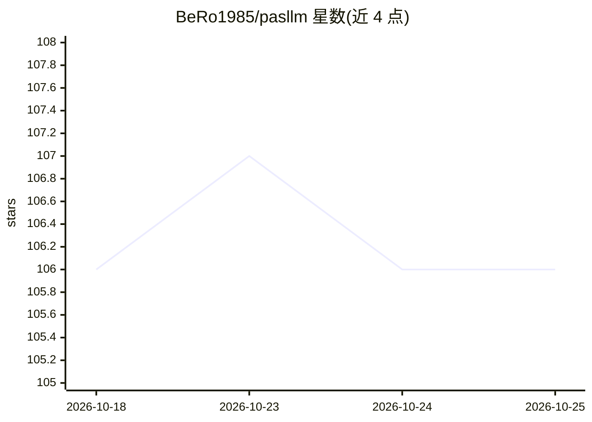

# BeRo1985/pasllm

⭐ 106 · Pascal · AGPL-3.0 · 推送 2026-05-01 · [GitHub](https://github.com/BeRo1985/pasllm) · 个人维护

**纯 Object Pascal 编写的本地 LLM 推理引擎（CPU）**

用纯 Object Pascal 实现的本地大模型推理引擎，无 Python 及外部推理依赖，兼容 Delphi ≥11.2 与 FreePascal ≥3.3.1，可在 32/64 位 x86 与 ARM 平台编译（推荐 64 位）。支持 Llama、Qwen、Phi、Gemma、Mixtral、DeepSeek R1 等架构，实现自定义 Q4*NL 系列 4-bit 量化及 Q80/FP8/FP16/BF16 等格式，提供 convert.py 从 Hugging Face 模型转换。当前仅 CPU 推理，GPU 加速与多模态、Mamba 等新架构尚未支持。提供 CLI 与 GUI（FMX/VCL/LCL）两种界面。

## 筛选速览

| 维度 | 判定 | 备注 |
|---|---|---|
| AI 角色 | `ai-ecosystem` | LLM/agent 周边工具 |
| 许可风险 | `dual` | AGPL-3.0 |
| 部署形态 | `None` |  |
| 模型依赖 | — | README 未给出锁定关系 |
| 硬件要求 | `cpu-ok` | |
| 安装摩擦 | `low` | 无编译、无系统依赖或容器化 |
| 成熟度 | `idea` | |

## 能力要点

- 纯 Object Pascal 实现，推理无 Python 或外部依赖
- 自定义 Q40NL/Q41NL/Q42NL/Q43NL 4-bit 量化格式及 FP8/FP16/BF16 等支持
- 支持 Llama/Qwen/Phi/Gemma/Mixtral/DeepSeek R1 等多架构
- 提供 CLI 与 GUI，及 Hugging Face 模型转换脚本 convert.py

## 适用场景

- 在 Delphi/FreePascal 环境中本地运行量化 LLM 推理
- 将 Hugging Face 模型转为自定义 Q4*NL 格式以压缩部署
- 在无 Python 运行时的机器上做 CPU 推理

## 场景标签

`推理引擎` `模型量化` · 领域:训练与推理

## 证据(README 行号)

> L7: A high-performance Large Language Model inference engine written in pure Object Pascal.
> L11: PasLLM is a native Pascal implementation for running LLMs locally with optimized quantization and inference capabil

## 星数曲线

2026-10-18 106 → 2026-10-25 106（+0）

---
*卡片 v1 · prompt 1.4 · 生成 2026-10-23 · 置信度 high · 依据 README sha `4d05ba83aa13` · [字段定义](../../DATASET.md)*
