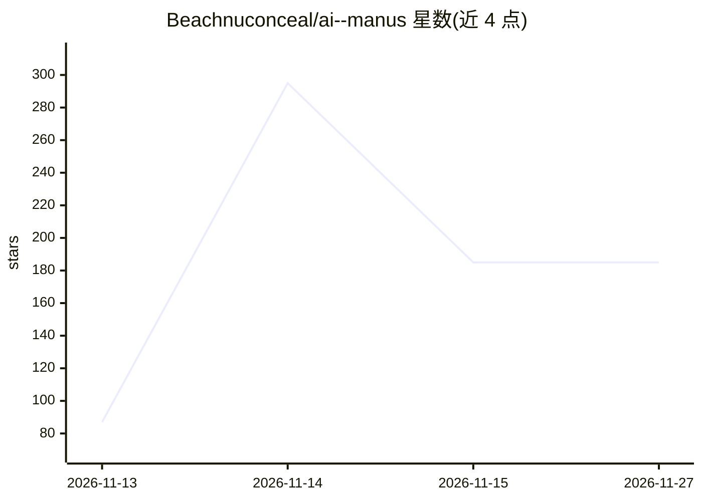

# Beachnuconceal/ai--manus

⭐ 185 · Apache-2.0 · 推送 2026-11-15 · [GitHub](https://github.com/Beachnuconceal/ai--manus) · 个人维护

**面向个人用户的自主 AI Agent，可执行代码与控制浏览器**

Manus 是一个自主 AI Agent 系统，在沙盒环境中运行工具：代理代码执行、浏览器控制（导航网页、填写表单、收集信息）与多步任务自动化，定位为家庭、学习与轻量办公场景的个人助手，用户无需编程背景。README 描述其在长会话中保持任务模式的一致性，代码与浏览器操作可在同一流程中衔接。文档为宣传式介绍，未提供安装命令、架构说明或模型接入方式的具体细节。

## 筛选速览

| 维度 | 判定 | 备注 |
|---|---|---|
| AI 角色 | `ai-native` | 本体是模型或模型工具 |
| 许可风险 | `permissive` | Apache-2.0 |
| 部署形态 | `None` |  |
| 模型依赖 | — | README 未给出锁定关系 |
| 硬件要求 | — | 无带数字的原话,不猜 |
| 安装摩擦 | `low` | 无编译、无系统依赖或容器化 |
| 成熟度 | — | 结构信号不足 |

## 能力要点

- 代理自主编写并执行代码完成任务
- 浏览器控制：导航网页、填写表单、收集信息
- 代码与浏览器操作衔接在同一任务流程中
- 在沙盒环境中运行各类工具与操作

## 适用场景

- 让学生整理研究笔记、运行小脚本
- 让代理替我检查网页更新、填写重复表单
- 远程工作者从多个页面收集数据并准备摘要

## 场景标签

`AI 助手` `浏览器自动化` `编码 Agent` · 领域:效率与自动化

## 证据(README 行号)

> L10: - **Autonomous Code Execution:** Manus AI agent runs code on its own to complete tasks, so you can focus on decisio
> L18: Manus is an autonomous AI agent designed to run code and control a browser on your behalf. Instead of acting like a

## 星数曲线

2026-11-13 87 → 2026-11-27 185（+98）

---
*卡片 v1 · prompt 1.4 · 生成 2026-11-17 · 置信度 low · 依据 README sha `0f78ee3a5dd2` · [字段定义](../../DATASET.md)*
