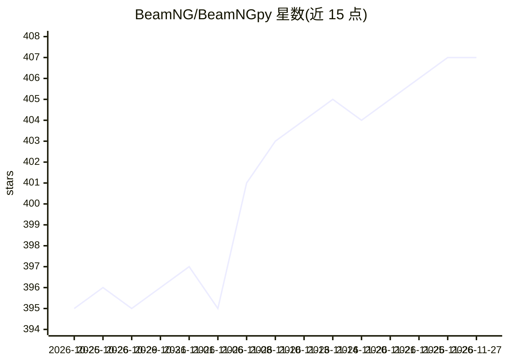

# BeamNG/BeamNGpy

⭐ 407 · Python · MIT · 推送 2026-11-23 · [GitHub](https://github.com/BeamNG/BeamNGpy) · [官网](https://beamng.tech) · 组织维护

**BeamNG.tech 模拟器的官方 Python API 控制库**

BeamNG 官方提供的 Python 库，通过客户端-服务器方式远程控制 BeamNG.tech 仿真：可逐车控制转向、灯光、换挡，配置模拟器内置的 AI 车辆（到点巡航、跟车、轨迹跟随），挂载相机/Lidar/IMU/超声波等传感器并获取带噪声选项的模拟数据，读取路网与场景对象，支持多客户端并行连接同一仿真。面向科研与工业界的自动驾驶仿真研究。使用前提是获取并安装 BeamNG.tech，且库版本与模拟器版本需按对照表匹配。

## 筛选速览

| 维度 | 判定 | 备注 |
|---|---|---|
| AI 角色 | `ai-ecosystem` | LLM/agent 周边工具 |
| 许可风险 | `permissive` | MIT |
| 部署形态 | `library` | 以包/库形式分发 |
| 模型依赖 | — | README 未给出锁定关系 |
| 硬件要求 | — | 无带数字的原话,不猜 |
| 安装摩擦 | `low` | 无编译、无系统依赖或容器化 |
| 成熟度 | — | 结构信号不足 |

## 能力要点

- 远程逐车控制：转向、油门、灯光、换挡
- 配置模拟器内置 AI 车辆（导航、跟车、用户轨迹）
- 相机/深度相机/Lidar/IMU/超声波等传感器模型，可选噪声数据
- 多客户端进程同时连接并控制同一仿真

## 适用场景

- 为自动驾驶算法生成仿真传感器数据
- 搭建多车场景并让各客户端分别控制车辆
- 读取路网几何与场景对象做仿真状态分析

## 场景标签

`科研工具` · 领域:学习与行业

## 证据(README 行号)

> L7: **BeamNGpy** is an official library providing a Python API to [BeamNG.tech][11],
> L13: It allows remote control of the simulation, including vehicles contained in it.
> L36: Besides manual control, BeamNG.tech ships with its own AI to control vehicles.

## 星数曲线

2026-10-25 395 → 2026-11-27 407（+12）

---
*卡片 v1 · prompt 1.4 · 生成 2026-11-25 · 置信度 high · 依据 README sha `900d701ab82b` · [字段定义](../../DATASET.md)*
