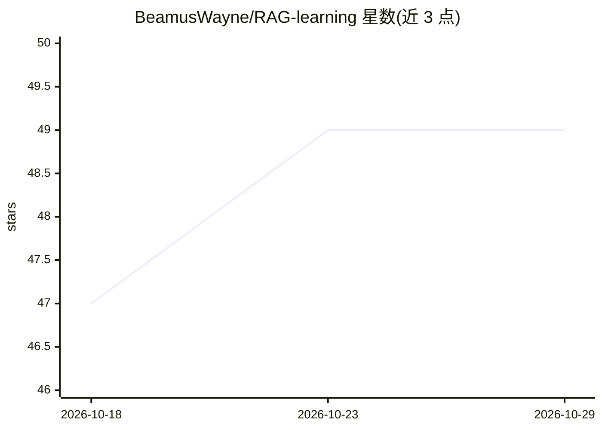

# BeamusWayne/RAG-learning

⭐ 49 · Python · MIT · 推送 2026-06-10 · [GitHub](https://github.com/BeamusWayne/RAG-learning) · 个人维护 · 中文 README

**RAG 从入门到生产的学习与实践教程仓库**

面向 RAG 学习者的中文教程与实践代码仓库：覆盖 LangChain 31 个渐进示例、LangGraph 图式编程、PydanticAI、Agno、LlamaIndex 等框架，以及 HyDE、RAGFusion、Self-RAG、CRAG、Agentic RAG、GraphRAG 等技术实现与实验项目；含 MultiLevelRAG 意图路由五策略对比平台、LangChain_RAG_Proj 企业级问答应用及视频合成、知识库问答等场景实验。安装走 uv/pip，LLM 接入支持 OpenAI、Ollama、DashScope、Gemini，部分子项目需 Neo4j、FFmpeg 等独立依赖。

## 筛选速览

| 维度 | 判定 | 备注 |
|---|---|---|
| AI 角色 | `ai-knowledge` | 知识聚合/清单类 |
| 许可风险 | `permissive` | MIT |
| 部署形态 | `library` | 以包/库形式分发 |
| 模型依赖 | local-ok | 支持本地模型 |
| 硬件要求 | — | 无带数字的原话,不猜 |
| 安装摩擦 | `medium` | 含编译或系统依赖之一 |
| 成熟度 | — | 结构信号不足 |

## 能力要点

- 覆盖 Naive/CRAG/Self-RAG/GraphRAG/Agentic RAG 等多种 RAG 范式的教程与可运行示例
- MultiLevelRAG：意图路由 × 5 种 RAG 策略 × Streamlit 对比平台
- LangChain 31 个循序渐进示例与企业级 RAG 问答项目
- 附 Self-RAG（arXiv:2310.11511）等论文整理与自测清单

## 适用场景

- 系统学习 RAG 技术范式与主流框架（LangChain/LangGraph/PydanticAI）
- 运行并对比 HyDE、RAGFusion、CRAG、GraphRAG 等策略实现
- 参考企业级 RAG 问答、知识库问答等完整项目工程实践

## 场景标签

`教程课程` `RAG` · 领域:知识与检索

## 证据(README 行号)

> L1: # RAG 学习与实践项目
> L3: 本项目为 **RAG（Retrieval-Augmented Generation，检索增强生成）** 的完整学习与实践仓库，覆盖从基础概念到生产级应用的完整技术栈，并包含多框架 Agent、图式工作流与实验性 RAG 改进（如 C

## 星数曲线

2026-10-18 47 → 2026-10-29 49（+2）

---
*卡片 v1 · prompt 1.4 · 生成 2026-10-25 · 置信度 high · 依据 README sha `0ab2ce628bad` · [字段定义](../../DATASET.md)*
