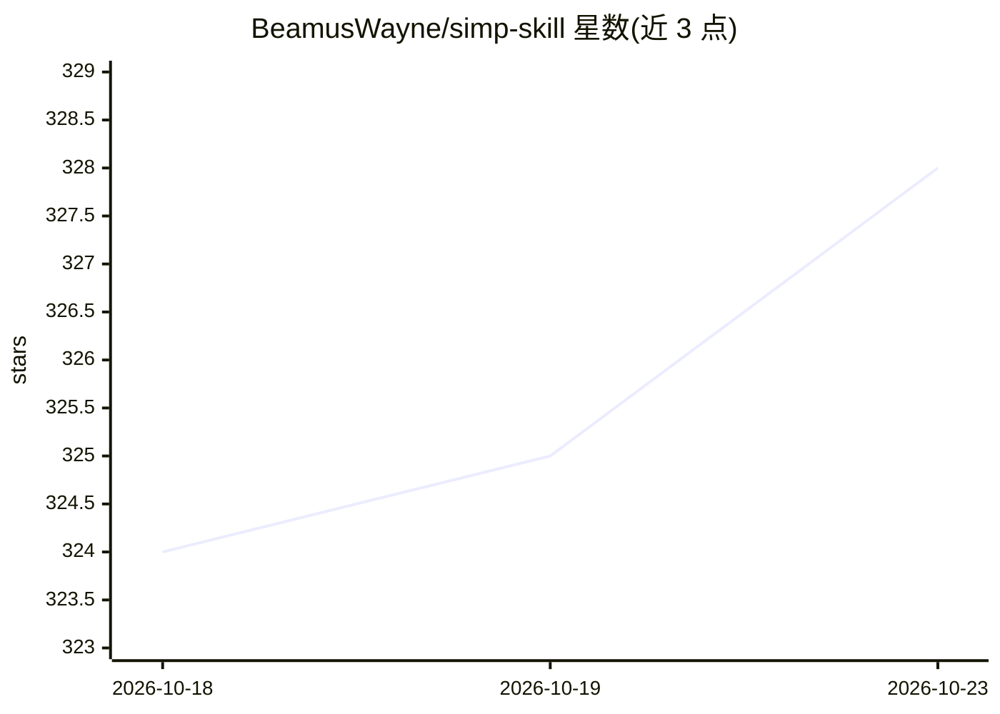

# BeamusWayne/simp-skill

⭐ 328 · Python · MIT · 推送 2026-10-16 · [GitHub](https://github.com/BeamusWayne/simp-skill) · 个人维护 · 中文 README

**面向 Claude Code 的恋爱追求辅助 skill，分析聊天记录并生成策略**

以 Claude Code skill 形式安装的恋爱追求辅助工具：通过 /simp 系列指令提供信号解读、情话生成、追求策略规划、表白定制与 11 类危机处理方案。附带本地 Python 工具链，可解析微信/QQ/JSON 聊天记录、社交媒体截图与照片元数据，量化感情温度并追踪互动时间；支持 MBTI 推断与纯情/策略/混合三种模式。设计原则声明数据本地化分析、不上传服务器、不教 PUA。需 Python 3.9+ 与 Claude Code 环境，git clone 安装。

## 筛选速览

| 维度 | 判定 | 备注 |
|---|---|---|
| AI 角色 | `ai-native` | 本体是模型或模型工具 |
| 许可风险 | `permissive` | MIT |
| 部署形态 | `library` | 以包/库形式分发 |
| 模型依赖 | — | README 未给出锁定关系 |
| 硬件要求 | — | 无带数字的原话,不猜 |
| 安装摩擦 | `low` | 无编译、无系统依赖或容器化 |
| 成熟度 | — | 结构信号不足 |

## 能力要点

- /simp 指令体系覆盖建档、信号解读、情话生成、表白定制与危机处理
- 本地解析微信/QQ/JSON 聊天记录、社交媒体截图、照片元数据
- 量化感情温度、互动时间与黄金时段分析，含 MBTI 推断
- 声明数据本地化分析，聊天记录不上传服务器

## 适用场景

- 分析聊天记录判断对方信号与关系阶段
- 根据情境生成情话与表白词
- 被拒、冷落、友谊区等场景下获取应对方案

## 场景标签

`AI 写作` · 领域:内容生成

## 证据(README 行号)

> L9: Claude Code
> L13: 提供聊天记录、社交媒体截图、照片，生成信号分析报告。
> L27: |📊 **聊天分析**|自动分析微信/QQ聊天记录，量化感情温度|

## 星数曲线

2026-10-18 324 → 2026-10-23 328（+4）

---
*卡片 v1 · prompt 1.4 · 生成 2026-10-22 · 置信度 mid · 依据 README sha `9153d699bce3` · [字段定义](../../DATASET.md)*
