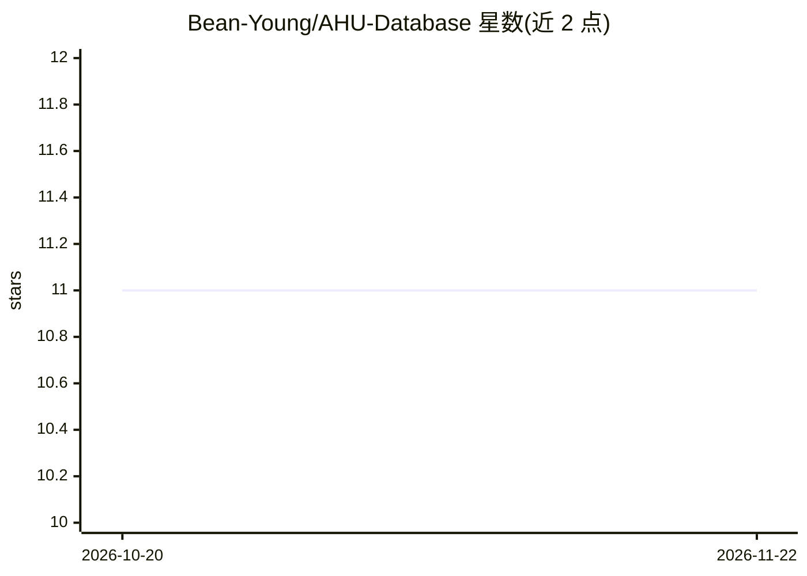

# Bean-Young/AHU-Database

⭐ 11 · Python · MIT · 推送 2026-04-28 · [GitHub](https://github.com/Bean-Young/AHU-Database) · [官网](https://bean-young.github.io/ahudataset/) · 个人维护

**面向 AI 超声诊断研究的异构标注超声数据库**

论文《An Annotated Heterogeneous Ultrasound Database》（Scientific Data, 2025）的配套数据集：从互联网公开数据收集 1,833 条超声数据，覆盖 13 种异常，全部匿名化，托管于 Figshare 并提供 Raw/Filtered/Processed 三种版本。附带预处理脚本（NPY 转换、DBSCAN 噪声识别）与基于 RViT、Top-3 Accuracy 的技术验证流程，环境为 PyTorch 2.0 + CUDA 11.8，实验平台 RTX 3090。

## 筛选速览

| 维度 | 判定 | 备注 |
|---|---|---|
| AI 角色 | `ai-knowledge` | 知识聚合/清单类 |
| 许可风险 | `permissive` | MIT |
| 部署形态 | `library` | 以包/库形式分发 |
| 模型依赖 | — | README 未给出锁定关系 |
| 硬件要求 | — | 无带数字的原话,不猜 |
| 安装摩擦 | `medium` | 含编译或系统依赖之一 |
| 成熟度 | — | 结构信号不足 |

## 能力要点

- 1,833 条异构超声数据、13 种异常标注、已匿名化
- 提供 Raw / Filtered / Processed 三档数据版本
- 附 To_NPY 转换与 DBSCAN 噪声识别预处理脚本
- 用 RViT 模型以 Top-3 Accuracy 验证数据集有效性

## 适用场景

- 开展多中心超声疾病诊断的基准测试
- 训练与评估超声图像异常分类模型
- 在异构设备数据上研究模型泛化性

## 场景标签

 · 领域:医疗影像/科研数据集

## 证据(README 行号)

> L11: Ultrasound is a primary diagnostic tool commonly used to evaluate internal body structures, including organs, blood
> L15: Our data is publicly available on Figshare. It includes **Raw Data**, **Filtered Data**, and **Processed Data**.

## 星数曲线

2026-10-20 11 → 2026-11-22 11（+0）

---
*卡片 v1 · prompt 1.4 · 生成 2026-11-19 · 置信度 high · 依据 README sha `58b7cda48e2d` · [字段定义](../../DATASET.md)*
