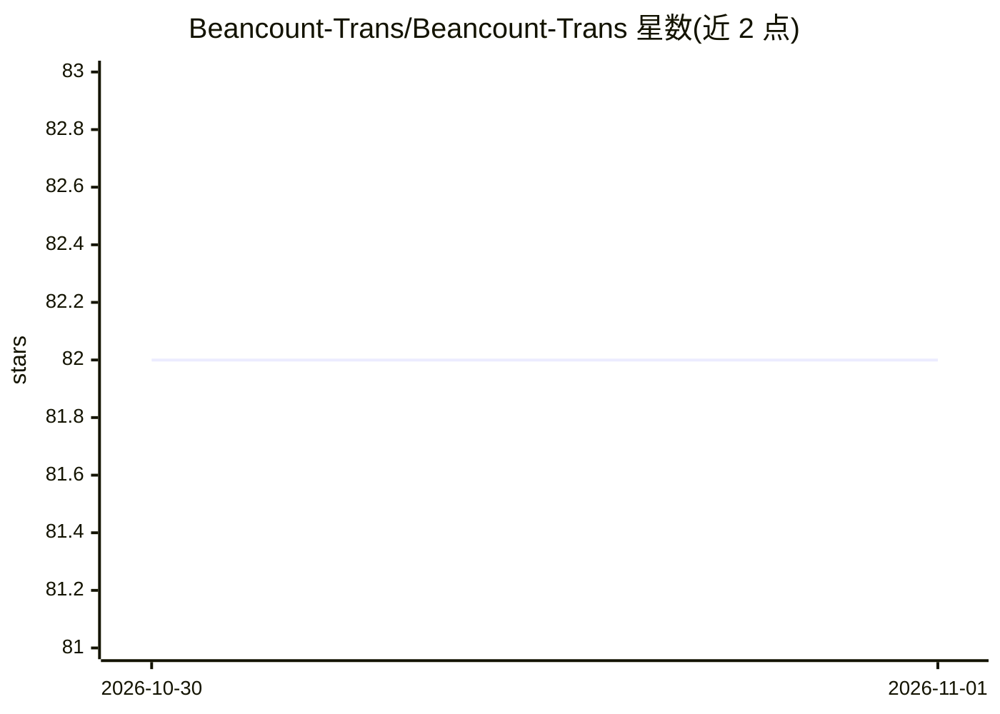

# Beancount-Trans/Beancount-Trans

⭐ 82 · JavaScript · MIT · 推送 2026-10-31 · [GitHub](https://github.com/Beancount-Trans/Beancount-Trans) · [官网](https://trans.dhr2333.cn/) · 组织维护 · 中文 README

**上传账单自动生成可审计 Beancount 复式记账与报表的平台**

面向复式记账用户的账单转换服务：上传账单后解析为 Beancount 格式数据，可查看与分析财务报表。分类环节在本地由 bert-base-chinese 模型完成，不经大模型，解析页不保留上传文件。提供云平台（注册即用）与自托管两条路径：自托管需 git clone、拉取 Hugging Face 模型并以 docker compose 启动，通过 localhost:38001 访问。项目为 open-core 结构，多仓库组成。

## 筛选速览

| 维度 | 判定 | 备注 |
|---|---|---|
| AI 角色 | `ai-enhanced` | 去掉 AI 部分产品仍成立 |
| 许可风险 | `permissive` | MIT |
| 部署形态 | `self-host` | docker 或自建部署 |
| 模型依赖 | — | README 未给出锁定关系 |
| 硬件要求 | — | 无带数字的原话,不猜 |
| 安装摩擦 | `low` | 无编译、无系统依赖或容器化 |
| 成熟度 | — | 结构信号不足 |

## 能力要点

- 账单自动解析为 Beancount 复式记账数据并生成报表
- 分类在本地由 bert-base-chinese 完成，不经大模型
- 提供云平台与 Docker 自托管两种使用方式
- 解析页不保留上传文件

## 适用场景

- 把支付宝/银行等账单转换为 Beancount 记账数据
- 在几分钟内查看个人财务报表
- 在本地自托管以保证账单隐私

## 场景标签

`文档解析` `数据分析` · 领域:效率与自动化

## 证据(README 行号)

> L9: **上传账单，自动转换为可审计的 Beancount 复式记账数据，并在几分钟内分析财务报表**。
> L15: 解析页不保留上传文件；分类在本地完成，不经大模型，无需担心账单隐私。
> L39: git clone https://huggingface.co/google-bert/bert-base-chinese ./Beancount-Trans-Backend/pretrained_models/bert-bas

## 星数曲线

2026-10-30 82 → 2026-11-01 82（+0）

---
*卡片 v1 · prompt 1.4 · 生成 2026-10-31 · 置信度 mid · 依据 README sha `ea7d0c50e03f` · [字段定义](../../DATASET.md)*
