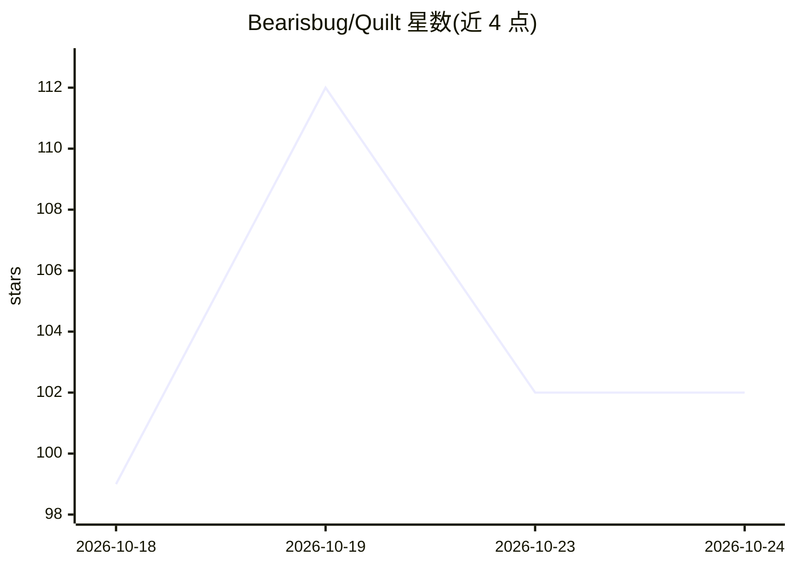

# Bearisbug/Quilt

⭐ 104 · TypeScript · Apache-2.0 · 推送 2026-10-24 · [GitHub](https://github.com/Bearisbug/Quilt) · 个人维护 · 中文 README

**本地运行的 AI 原型设计工具：一句话生成多屏 HTML 原型**

完全在本地单进程运行的无限画布设计工具：用户描述一个应用，系统规划 4-6 屏主流程并生成符合设计系统的自包含 HTML 屏幕，经 lint、截图后平铺在可平移缩放的画布上；支持原样点按链接播放原型、元素级零 token 编辑与 AI 重生成子树、共享组件、修订树回滚。生成通道可选本地 Claude 订阅（claude CLI）、Anthropic/Gemini/OpenAI 兼容 API key 或已打开的 Claude Code 会话；另通过 MCP（53 个工具）让本地编码 agent 读写画布。需要 Node.js 22+、pnpm 11 与 Chrome/Edge，数据存于 ~/.quilt。

## 筛选速览

| 维度 | 判定 | 备注 |
|---|---|---|
| AI 角色 | `ai-native` | 本体是模型或模型工具 |
| 许可风险 | `permissive` | Apache-2.0 |
| 部署形态 | `self-host` | docker 或自建部署 |
| 模型依赖 | locked-api |  |
| 硬件要求 | — | 无带数字的原话,不猜 |
| 安装摩擦 | `low` | 无编译、无系统依赖或容器化 |
| 成熟度 | — | 结构信号不足 |

## 能力要点

- 一句话生成多屏 HTML 设计并作为原型点按播放
- 元素级零 token 编辑与 AI 重生成子树、每屏最多 4 个候选版本
- 本地 MCP 服务暴露 53 个工具与 7 个资源，供编码 agent 读写画布
- 多通道生成：本地 Claude 订阅、Anthropic/Gemini/OpenAI 兼容端点、Claude Code 会话

## 适用场景

- 快速把想法变成可点击的多屏应用原型
- 让本地编码 agent 通过 MCP 直接读写设计画布
- 维护项目级设计系统并一键重排所有屏幕

## 场景标签

`代码生成` · 领域:编码与开发

## 证据(README 行号)

> L5:  AI-native infinite-canvas design tool.
> L28: - **Generate** ("造"). Type what the app is. The planner lays out a 4–6 screen main flow (or exactly the number you 

## 星数曲线

2026-10-18 99 → 2026-10-24 102（+3）

---
*卡片 v1 · prompt 1.4 · 生成 2026-10-23 · 置信度 mid · 依据 README sha `97275263bc67` · [字段定义](../../DATASET.md)*
