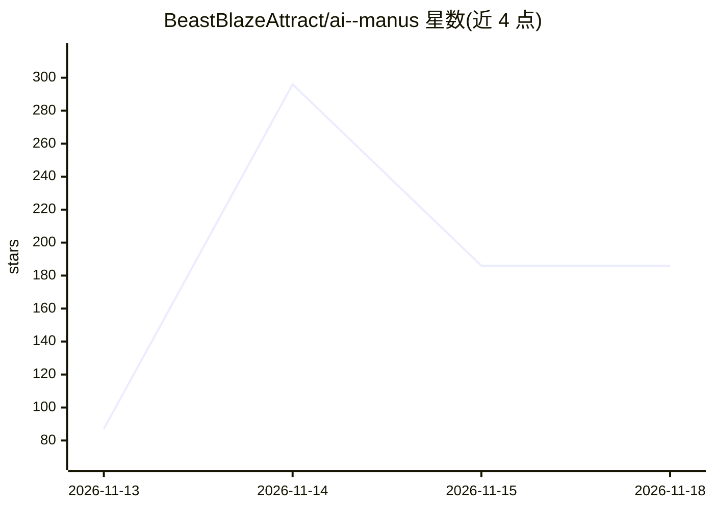

# BeastBlazeAttract/ai--manus

⭐ 186 · Apache-2.0 · 推送 2026-11-15 · [GitHub](https://github.com/BeastBlazeAttract/ai--manus) · 个人维护

**面向个人用户的自主 AI Agent：代为执行代码与浏览器操作**

自述为通用自主 AI Agent 系统，可在沙箱环境中运行工具与操作：自主编写并执行脚本、控制浏览器（导航网页、填写表单、抓取信息）、执行多步骤任务。定位为家庭、学习与轻量工作场景的个人助手，明确声明非企业平台。README 仅含功能描述、硬件兼容表与使用步骤，未提供安装命令、源码结构或 API 接入方式，实际获取途径仅有'下载'与促销码字样，可验证的实现细节缺失。

## 筛选速览

| 维度 | 判定 | 备注 |
|---|---|---|
| AI 角色 | `ai-native` | 本体是模型或模型工具 |
| 许可风险 | `permissive` | Apache-2.0 |
| 部署形态 | `None` |  |
| 模型依赖 | — | README 未给出锁定关系 |
| 硬件要求 | — | 无带数字的原话,不猜 |
| 安装摩擦 | `low` | 无编译、无系统依赖或容器化 |
| 成熟度 | — | 结构信号不足 |

## 能力要点

- 自主编写并执行代码完成任务
- 浏览器控制：导航、填表、信息抓取
- 脚本执行与浏览器操作可在同一任务流中衔接
- 面向家庭、学习与轻量工作的小规模场景

## 适用场景

- 让代理代为跑脚本和整理研究资料
- 自动浏览网页、填表和收集信息
- 把重复性的小型日常任务委托给后台代理

## 场景标签

`AI 助手` `浏览器自动化` `编码 Agent` · 领域:效率与自动化

## 证据(README 行号)

> L18: Manus is an autonomous AI agent designed to run code and control a browser on your behalf. Instead of acting like a
> L22: Manus is not a heavy studio suite or a complex enterprise platform. It is a focused helper built for home, study, a

## 星数曲线

2026-11-13 87 → 2026-11-18 186（+99）

---
*卡片 v1 · prompt 1.4 · 生成 2026-11-17 · 置信度 mid · 依据 README sha `a3d88e202bf0` · [字段定义](../../DATASET.md)*
