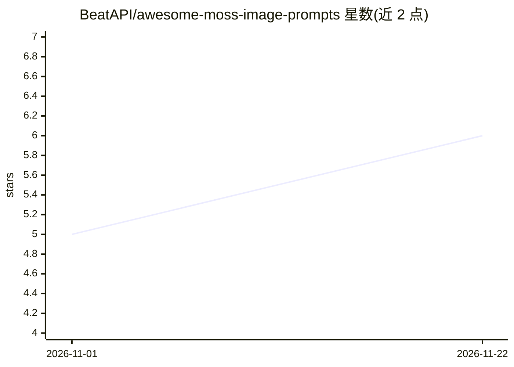

# BeatAPI/awesome-moss-image-prompts

⭐ 6 · Python · 推送 2026-10-22 · [GitHub](https://github.com/BeatAPI/awesome-moss-image-prompts) · [官网](https://beatapi.io/moss-image-prompts) · 组织维护 · 中文 README

**MOSS-Image 提示词示例库：500 条附图与生成参数的案例集**

由 BeatAPI 整理的 MOSS-Image 文生图提示词示例集，收录 500 条带生成图、完整提示词与分辨率设置的条目，按海报/平面设计、产品广告、人像时尚、自然动物、建筑空间、插画动漫、创意电影感等用途分类组织。每条示例以图片链接加提示词文本的形式呈现，提示词含中英文案例。仓库以清单形式分发，另提供在线画廊与 ZIP 下载入口；README 未给出本地安装或运行说明。

## 筛选速览

| 维度 | 判定 | 备注 |
|---|---|---|
| AI 角色 | `ai-knowledge` | 知识聚合/清单类 |
| 许可风险 | `none` | — |
| 部署形态 | `None` |  |
| 模型依赖 | — | README 未给出锁定关系 |
| 硬件要求 | — | 无带数字的原话,不猜 |
| 安装摩擦 | `low` | 无编译、无系统依赖或容器化 |
| 成熟度 | — | 结构信号不足 |

## 能力要点

- 500 条示例均附生成图、完整提示词与分辨率设置
- 按 8 个用例分类（海报 44、人像 104、插画动漫 103 等）
- 提供在线画廊、全量提示词页、中文版与 ZIP 下载入口

## 适用场景

- 写 MOSS-Image 提示词时查找同类型参考案例
- 为海报、产品图、人像等设计任务寻找提示词模板
- 研究中英文长提示词的结构与写法

## 场景标签

`图像生成` `精选清单` · 领域:内容生成

## 证据(README 行号)

> L3: # Awesome MOSS-Image Prompts
> L5: **500 MOSS-Image examples with images, complete prompts and generation settings.** Posters, products, portraits, ill
> L11: |Collection|Examples|

## 星数曲线

2026-11-01 5 → 2026-11-22 6（+1）

---
*卡片 v1 · prompt 1.4 · 生成 2026-11-21 · 置信度 high · 依据 README sha `4ba48230077a` · [字段定义](../../DATASET.md)*
