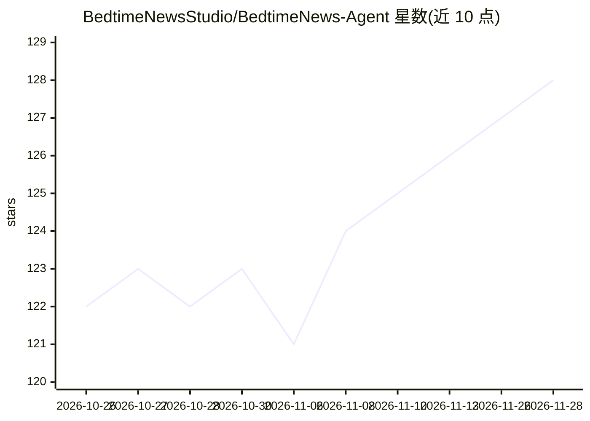

# BedtimeNewsStudio/BedtimeNews-Agent

⭐ 128 · Python · MIT · 推送 2026-11-23 · [GitHub](https://github.com/BedtimeNewsStudio/BedtimeNews-Agent) · [官网](https://bedtime.blog) · 组织维护 · 中文 README

**面向睡前消息观众的节目文稿问答与阅读网站**

以智能 RAG（检索增强生成）为核心的「睡前消息」节目文稿知识库：索引来自姊妹仓库的文稿，提供聊天问答与站内文稿浏览。核心机制包括自动查询路由、语义搜索、基于 LLM 的文档相关性评分、Markdown 引用与引用修复；索引以不可变快照发布，Agent 以只读角色读取并可在 15 秒内切换快照。基于 LangGraph、OpenAI-compatible 端点与 PostgreSQL + pgvector 构建，通过 Docker Compose 部署，服务栈仅提供纯 HTTP、TLS 需外部处理。

## 筛选速览

| 维度 | 判定 | 备注 |
|---|---|---|
| AI 角色 | `ai-native` | 本体是模型或模型工具 |
| 许可风险 | `permissive` | MIT |
| 部署形态 | `self-host` | docker 或自建部署 |
| 模型依赖 | — | README 未给出锁定关系 |
| 硬件要求 | — | 无带数字的原话,不猜 |
| 安装摩擦 | `low` | 无编译、无系统依赖或容器化 |
| 成熟度 | — | 结构信号不足 |

## 能力要点

- 自动路由 + 语义搜索 + LLM 相关性评分的 Agentic RAG 流水线
- 不可变快照发布：原子、可回滚，Agent 无需重启切换
- 回答附 Markdown 引用，链接跳转站内文稿阅读器
- 蓝绿部署支持：两个版本可共用数据库同时运行

## 适用场景

- 向 AI 提问睡前消息节目内容并核对原文出处
- 站内检索、浏览与阅读全部节目文稿
- 自托管部署一个带增量索引的文稿问答服务

## 场景标签

`聊天机器人` `RAG` `文档问答` · 领域:对话与助手

## 证据(README 行号)

> L12: 睡前消息知识库网站：既能向智能体提问，也能在站内浏览与阅读全部节目文稿。
> L23: 睡前消息文稿库（BedtimeNews-Transcripts）中维护；本仓库（BedtimeNews-Agent）索引这些文稿，并运行同时提供聊天问答与站内文稿阅读的网站——索引到的文稿直接作为站内内容供浏览，回答中的引用也跳转
> L43: - **Agent**：基于 LangGraph 的智能 RAG 服务

## 星数曲线

2026-10-26 122 → 2026-11-28 128（+6）

---
*卡片 v1 · prompt 1.4 · 生成 2026-11-28 · 置信度 high · 依据 README sha `bb72eac7e02d` · [字段定义](../../DATASET.md)*
