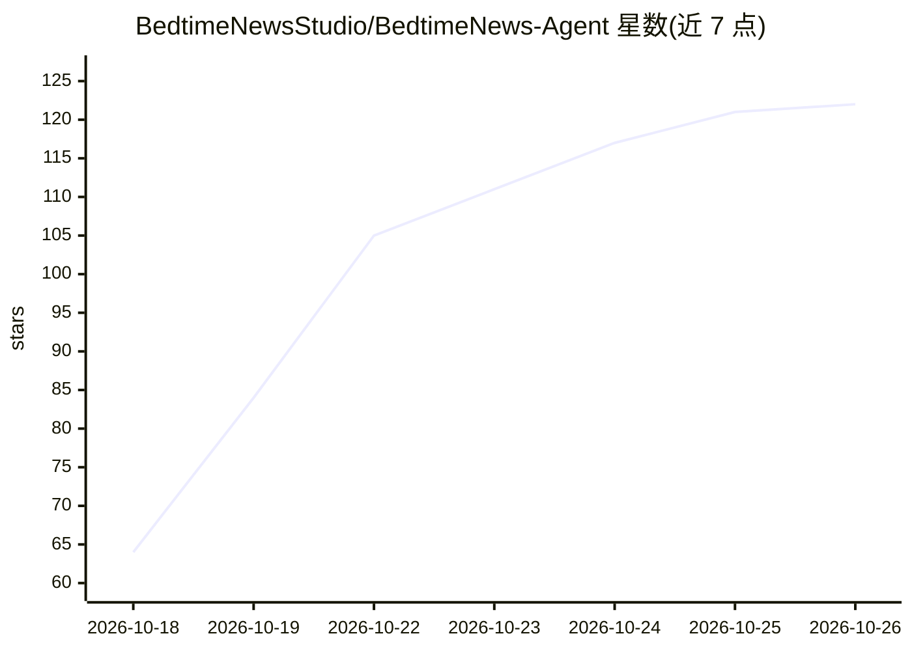

# BedtimeNewsStudio/BedtimeNews-Agent

⭐ 122 · Python · MIT · 推送 2026-10-20 · [GitHub](https://github.com/BedtimeNewsStudio/BedtimeNews-Agent) · [官网](https://bedtime.blog) · 组织维护 · 中文 README

**睡前消息节目文稿知识库与智能 RAG 问答网站**

面向睡前消息观众与自托管部署者的网站：索引文稿库中的节目文稿，站内可浏览阅读全文，也可通过基于 LangGraph 的智能 RAG 系统提问，自动路由、语义搜索、引用跳转到应用内阅读器。任意 OpenAI-compatible 对话/嵌入端点均可（默认模板 DeepSeek 对话 + SiliconFlow Qwen3 embedding），存储用 PostgreSQL + pgvector；索引以不可变快照发布、原子切换。通过 Docker Compose 部署，需自备 API 密钥。

## 筛选速览

| 维度 | 判定 | 备注 |
|---|---|---|
| AI 角色 | `ai-native` | 本体是模型或模型工具 |
| 许可风险 | `permissive` | MIT |
| 部署形态 | `self-host` | docker 或自建部署 |
| 模型依赖 | locked-api |  |
| 硬件要求 | — | 无带数字的原话,不猜 |
| 安装摩擦 | `low` | 无编译、无系统依赖或容器化 |
| 成熟度 | — | 结构信号不足 |

## 能力要点

- 基于 LangGraph 的智能 RAG：查询路由、优化、语义搜索与 LLM 相关性评分
- 不可变快照式索引发布，Agent 无需重启 15 秒内切换，支持蓝绿零停机升级
- 站内文稿浏览与引用跳转到应用内阅读器
- 任意 OpenAI-compatible 对话/嵌入端点均可配置

## 适用场景

- 向睡前消息知识库提问并获取带文稿引用的回答
- 站内浏览与阅读全部节目文稿
- 自托管一套针对自有文稿库的 RAG 问答网站

## 场景标签

`RAG` `文档问答` · 领域:知识与检索

## 证据(README 行号)

> L12: 睡前消息知识库网站：既能向智能体提问，也能在站内浏览与阅读全部节目文稿。
> L23: 睡前消息文稿库（BedtimeNews-Transcripts）中维护；本仓库（BedtimeNews-Agent）索引这些文稿，并运行同时提供聊天问答与站内文稿阅读的网站——索引到的文稿直接作为站内内容供浏览，回答中的引用也跳转
> L43: - **Agent**：基于 LangGraph 的智能 RAG 服务

## 星数曲线

2026-10-18 64 → 2026-10-26 122（+58）

---
*卡片 v1 · prompt 1.4 · 生成 2026-10-23 · 置信度 high · 依据 README sha `058a3289e013` · [字段定义](../../DATASET.md)*
