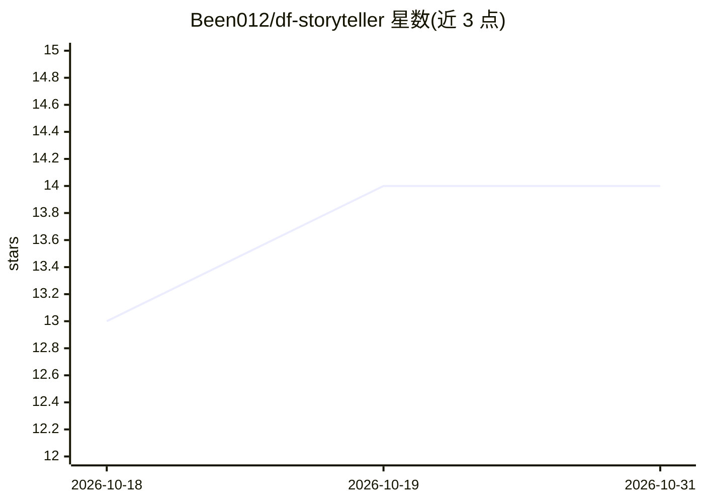

# Been012/df-storyteller

⭐ 14 · Python · MIT · 推送 2026-04-06 · [GitHub](https://github.com/Been012/df-storyteller) · [官网](https://github.com/Been012/df-storyteller/wiki) · 个人维护

**矮人要塞玩家的编年史日志与传说浏览器，可选 AI 辅助写作**

面向 Dwarf Fortress 玩家的本地伴侣工具：通过 DFHack 钩子实时捕获要塞事件，提供传说历史浏览器（人物/文明/战争/艺术品详情页、Leaflet 世界地图、节日历法、家族树）、要塞日志（角色卡、季节编年史、军事看板、关系网络图）与跨引用系统（Lore Pins、[[热链接]]）。AI 为可选功能：接入 Ollama/Claude/OpenAI 后可基于真实游戏数据生成编年史、传记、日记、讣告与战报，支持流式输出与采样参数调节；不接 AI 时全部功能可手动使用。以 pip 包或源码安装，需 DF v50.x 与 DFHack。

## 筛选速览

| 维度 | 判定 | 备注 |
|---|---|---|
| AI 角色 | `ai-enhanced` | 去掉 AI 部分产品仍成立 |
| 许可风险 | `permissive` | MIT |
| 部署形态 | `library` | 以包/库形式分发 |
| 模型依赖 | local-ok | 支持本地模型 |
| 硬件要求 | — | 无带数字的原话,不猜 |
| 安装摩擦 | `low` | 无编译、无系统依赖或容器化 |
| 成熟度 | — | 结构信号不足 |

## 能力要点

- DFHack 钩子实时捕获游戏事件（非 gamelog 解析）
- 传说浏览器覆盖 97 种历史事件类型并全量可点击交叉引用
- 可选 LLM 生成编年史/传记/日记，基于真实游戏数据且支持真流式输出
- 像素级矮人肖像从 DF 自带贴图表生成，支持 5 种种族

## 适用场景

- 记录并浏览要塞与世界的历史、人物关系与战争
- 手动或用 AI 为矮人写传记、日记与季节编年史
- 在游戏过程中实时查看战斗、婚嫁、巨兽来袭等事件流

## 场景标签

`AI 写作` · 领域:内容生成

## 证据(README 行号)

> L3: A companion journal and legends browser for Dwarf Fortress. Track your fortress, explore world history, chart relati
> L66: - No AI required — every feature works in manual mode

## 星数曲线

2026-10-18 13 → 2026-10-31 14（+1）

---
*卡片 v1 · prompt 1.4 · 生成 2026-10-31 · 置信度 high · 依据 README sha `6691cae8c501` · [字段定义](../../DATASET.md)*
