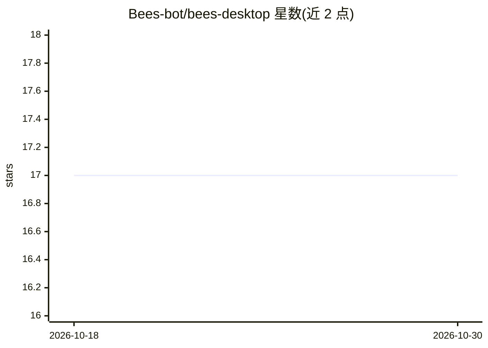

# Bees-bot/bees-desktop

⭐ 17 · JavaScript · Apache-2.0 · 推送 2026-10-29 · [GitHub](https://github.com/Bees-bot/bees-desktop) · [官网](https://bees.bot) · 组织维护

**本地优先的桌面 AI agent 团队客户端，文件与凭证留在本机**

基于 Tauri/Node 的桌面应用，让用户在本机运行一组 AI agent：以线程组织对话与目标，支持 Work/审查/批准阶段、定时调度、MCP 集成、浏览器访问与本地文件存储（SQLite + 内容寻址文件，位于 ~/Bees）。可接入 Claude Code、Codex、托管或本地 OpenAI 兼容模型。数据默认本地执行，账号仅用于共享或跨机迁移；支持线程共享、跨客户端迁移（校验检查点哈希）、企业私有 Bees Server 部署及 Docker 托管客户端。另有 Hindsight 自动记忆与基于积分的托管计费（Stripe）。

## 筛选速览

| 维度 | 判定 | 备注 |
|---|---|---|
| AI 角色 | `ai-native` | 本体是模型或模型工具 |
| 许可风险 | `permissive` | Apache-2.0 |
| 部署形态 | `self-host` | docker 或自建部署 |
| 模型依赖 | — | README 未给出锁定关系 |
| 硬件要求 | — | 无带数字的原话,不猜 |
| 安装摩擦 | `low` | 无编译、无系统依赖或容器化 |
| 成熟度 | — | 结构信号不足 |

## 能力要点

- 线程式 agent 团队：Work/独立审查/用户批准三阶段流程
- 本地优先：SQLite 文档与内容寻址文件存于本机，凭证按机器隔离
- 支持 Claude Code、Codex、托管或本地 OpenAI 兼容模型及 MCP 工具
- 线程可在客户端间迁移（冻结检查点并校验哈希），支持私有 Server 部署

## 适用场景

- 在自己电脑上运行多 agent 团队处理目标与日常任务
- 让 agent 提交带表单与可编辑表格的审查屏，由我批准或修改
- 在不联网的企业内网用私有 Bees Server 组织协作

## 场景标签

`多智能体` `浏览器自动化` `AI 助手` · 领域:Agent 开发

## 证据(README 行号)

> L7: Chat alternates between your message and an AI reply, retaining conversation history for each turn. Its single Chat 
> L19: Team settings → Agents creates named agents with instructions, a preset, model, reasoning effort, and add-on access

## 星数曲线

2026-10-18 17 → 2026-10-30 17（+0）

---
*卡片 v1 · prompt 1.4 · 生成 2026-10-30 · 置信度 high · 依据 README sha `f6aa26281253` · [字段定义](../../DATASET.md)*
