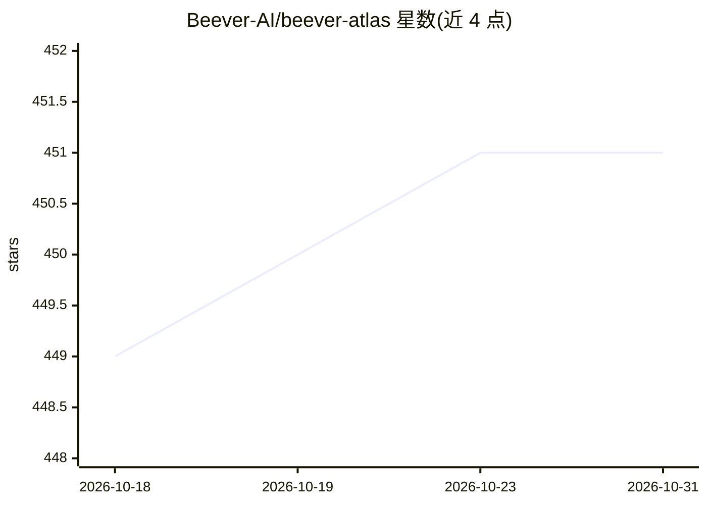

# Beever-AI/beever-atlas

⭐ 451 · Python · Apache-2.0 · 推送 2026-09-10 · [GitHub](https://github.com/Beever-AI/beever-atlas) · [官网](https://docs.beever.ai/atlas) · 组织维护

**把团队聊天自动转化为带引用的维基知识库并支持问答**

面向团队的 LLM 知识库应用：从 Slack、Discord、Teams、Mattermost 同步聊天记录，经 6 阶段 ADK 流水线提取原子事实、实体与关系，去重后聚合成按频道自动维护的维基页面（主题、人员、决策、引用），并由双层记忆（三层语义存储 + 图存储）驱动 QA Agent，给出可溯源到源消息的回答。同时以 MCP server 形式接入 Claude Code 与 Cursor（28 个工具）。以 Docker Compose 栈交付（backend/bot/web + Weaviate/Neo4j/MongoDB/Redis），安装需 GOOGLE_API_KEY 与 JINA_API_KEY 两个免费 API key。

## 筛选速览

| 维度 | 判定 | 备注 |
|---|---|---|
| AI 角色 | `ai-native` | 本体是模型或模型工具 |
| 许可风险 | `permissive` | Apache-2.0 |
| 部署形态 | `self-host` | docker 或自建部署 |
| 模型依赖 | local-ok | 支持本地模型 |
| 硬件要求 | — | 无带数字的原话,不猜 |
| 安装摩擦 | `low` | 无编译、无系统依赖或容器化 |
| 成熟度 | — | 结构信号不足 |

## 能力要点

- 6 阶段 ADK 流水线将聊天蒸馏为原子事实、实体与关系
- 双层记忆架构：三层语义存储 + 图存储，查询路由按问题选择检索策略
- 每个回答可引用溯源到源消息
- MCP server 提供 28 个工具接入 Claude Code / Cursor，支持 per-agent 认证

## 适用场景

- 把 Slack/Discord/Teams 频道沉淀为可浏览的团队维基
- 新成员入组时阅读蒸馏后的维基而非翻阅数月聊天记录
- 通过仪表盘或 Claude Code/Cursor 用自然语言查询团队知识

## 场景标签

`Agent 记忆` `知识库管理` `文档问答` · 领域:Agent 开发

## 证据(README 行号)

> L22: Beever Atlas pulls the conversations your team already has on Slack, Discord, Microsoft Teams, and Mattermost, extr
> L56: Conversations from any supported platform flow into a unified ingestion pipeline that produces two complementary me
> L200: |Backend|`:8000`|FastAPI + ADK agents|

## 星数曲线

2026-10-18 449 → 2026-10-31 451（+2）

---
*卡片 v1 · prompt 1.4 · 生成 2026-10-21 · 置信度 high · 依据 README sha `776dede12e5b` · [字段定义](../../DATASET.md)*
