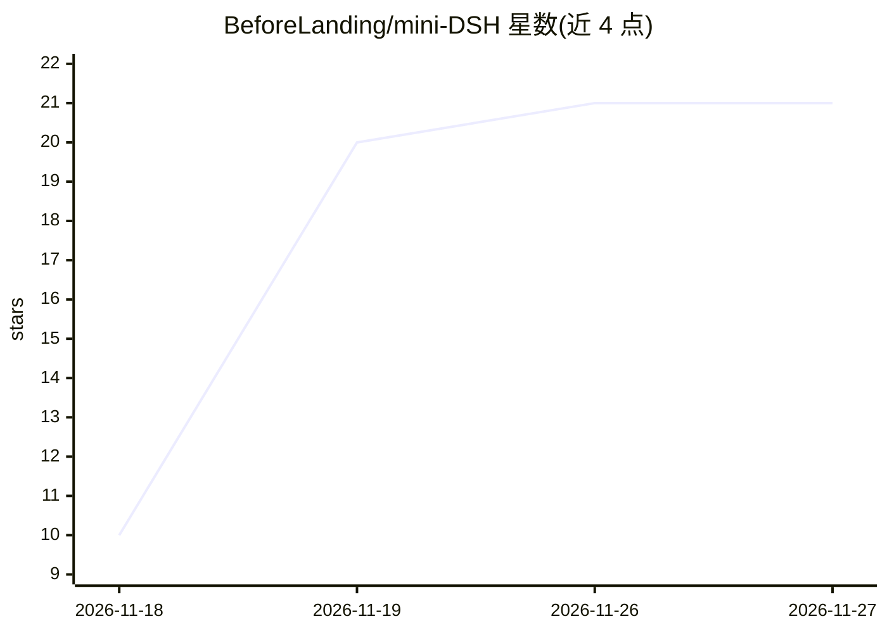

# BeforeLanding/mini-DSH

⭐ 21 · TypeScript · MIT · 推送 2026-11-23 · [GitHub](https://github.com/BeforeLanding/mini-DSH) · [官网](https://github.com/BeforeLanding/mini-DSH/releases) · 组织维护 · 中文 README

**本地代码仓库的 CLI 编程 Agent，支持恢复与预算控制**

在本地代码仓库中运行的 CLI coding agent，TypeScript 编写，构建于 Cordis 插件系统。会话保存为追加式 JSONL 事件日志，进程崩溃或预算耗尽后可从日志重建状态并继续，结果未知的工具调用不自动重跑；提供请求/token 预算、写文件与 Bash 审批闸门、多 agent 编排（独立 git worktree）与离线评测演示。需要 Node.js 22+、pnpm 与 Bash，尚未发布到 npm，macOS 安装未验证。

## 筛选速览

| 维度 | 判定 | 备注 |
|---|---|---|
| AI 角色 | `ai-native` | 本体是模型或模型工具 |
| 许可风险 | `permissive` | MIT |
| 部署形态 | `library` | 以包/库形式分发 |
| 模型依赖 | locked-api |  |
| 硬件要求 | — | 无带数字的原话,不猜 |
| 安装摩擦 | `low` | 无编译、无系统依赖或容器化 |
| 成熟度 | `idea` | |

## 能力要点

- JSONL 事件日志驱动的崩溃恢复与任务续跑
- 模型请求/工具调用/时间/token 可配置预算控制
- 多 agent 编排：每 worker 独立 harness 与 git worktree
- 内置 DeepSeek 流式协议适配器，90 道 SWE-bench Verified 评测数据

## 适用场景

- 在本地仓库让 agent 读规则、定位、编辑并跑检查
- 长任务被预算中断后从事件日志恢复继续
- 多 worker 并行子任务并在宿主按序整合

## 场景标签

`编码 Agent` · 领域:编码与开发

## 证据(README 行号)

> L5: mini-DSH 是一个在本地代码仓库中运行的cli coding agent。它用 TypeScript 编写，构建于 Cordis 插件系统之上，内置 DeepSeek 模型适配器。
> L84: |`src/core/`|agent loop（智能体循环）、事件日志、恢复、上下文与预算|

## 星数曲线

2026-11-18 10 → 2026-11-27 21（+11）

---
*卡片 v1 · prompt 1.4 · 生成 2026-11-19 · 置信度 mid · 依据 README sha `273057858ad1` · [字段定义](../../DATASET.md)*
