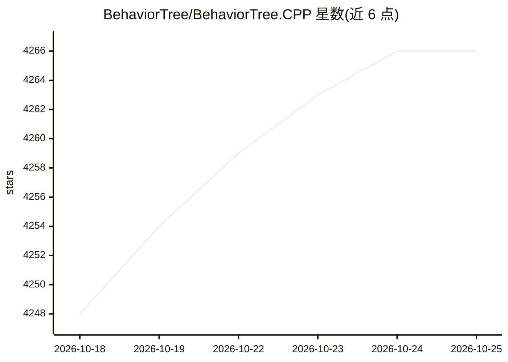

# BehaviorTree/BehaviorTree.CPP

⭐ 4,267 · C++ · MIT · 推送 2026-10-24 · [GitHub](https://github.com/BehaviorTree/BehaviorTree.CPP) · [官网](https://behaviortree.dev) · 个人维护

**C++17 行为树框架：为机器人和游戏构建任务协调逻辑**

以 C++17 实现的行为树（Behavior Trees）库，主要面向机器人领域，也可用于构建游戏 AI 或替代有限状态机。关键机制包括：异步非阻塞 Action 为一等公民、可并发执行多 Action 的反应式行为、基于 XML 的 DSL 在运行时加载树结构、自定义节点可静态链接或编译为插件运行时加载、节点间类型安全的数据流，以及可视化/录制/回放状态转移的日志分析设施。需自行编译（支持 conan、colcon/ROS2、CMake、pixi、vcpkg），并提供付费商业支持联系方式。

## 筛选速览

| 维度 | 判定 | 备注 |
|---|---|---|
| AI 角色 | `ai-ecosystem` | LLM/agent 周边工具 |
| 许可风险 | `permissive` | MIT |
| 部署形态 | `None` |  |
| 模型依赖 | — | README 未给出锁定关系 |
| 硬件要求 | — | 无带数字的原话,不猜 |
| 安装摩擦 | `medium` | 含编译或系统依赖之一 |
| 成熟度 | — | 结构信号不足 |

## 能力要点

- 异步非阻塞 Action 与反应式并发行为
- 基于 XML 的 DSL，树结构运行时加载，不硬编码
- 自定义 TreeNode 可转为插件运行时加载
- 内置日志/profiling 基础设施，可录制回放分析状态转移

## 适用场景

- 机器人任务编排与行为协调
- 游戏 AI 逻辑开发
- 替代有限状态机组织复杂控制流

## 场景标签

 · 领域:机器人/游戏 AI 基础设施

## 证据(README 行号)

> L10: This __C++ 17__ library provides a framework to create BehaviorTrees.
> L13: Even if our main use-case is __robotics__, you can use this library to build
> L14: __AI for games__, or to replace Finite State Machines.

## 星数曲线

2026-10-18 4,248 → 2026-10-25 4,266（+18）

---
*卡片 v1 · prompt 1.4 · 生成 2026-10-20 · 置信度 high · 依据 README sha `8a3fbbda6408` · [字段定义](../../DATASET.md)*
