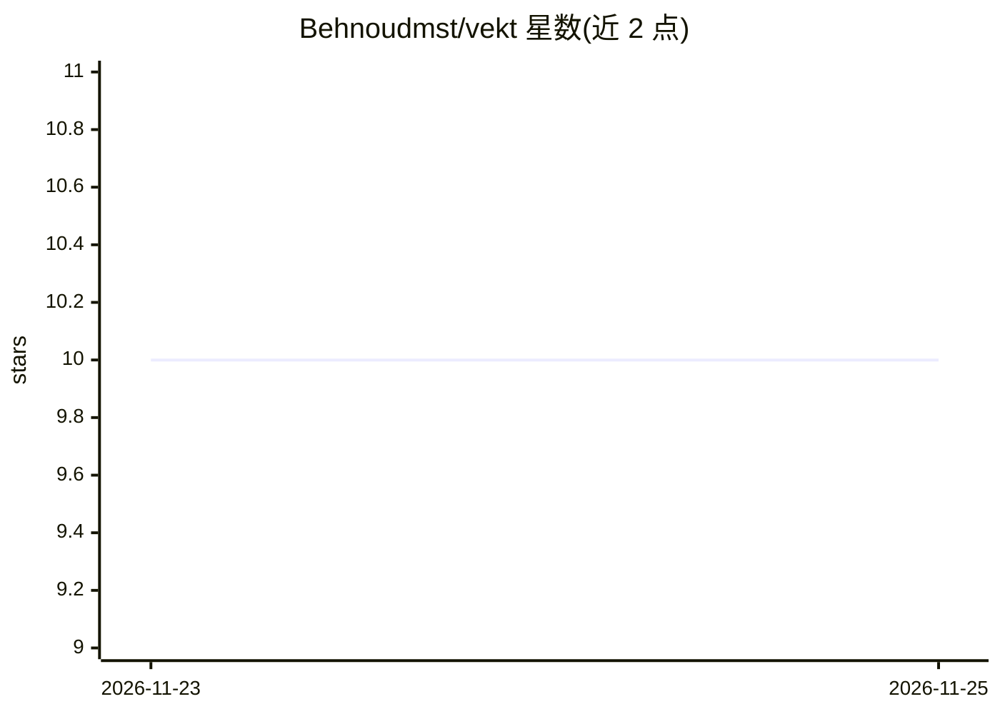

# Behnoudmst/vekt

⭐ 10 · TypeScript · MIT · 推送 2026-11-04 · [GitHub](https://github.com/Behnoudmst/vekt) · [官网](https://vekt.eu) · 个人维护

**自托管招聘平台：AI 简历筛选与候选人排名**

开源（MIT）的自托管招聘平台：招聘者发布职位、候选人提交 PDF 简历，由 Inngest 驱动的评估流水线用 AI 对相关性（权重 0.4）与经验（权重 0.6）打分排序。隐私机制包括 CV 送入 AI 前剥离身份信息、可配置数据保留与自动清除、延迟发送状态邮件、低于阈值标记需人工复核而非自动拒信。AI 评分 provider 可插拔（默认 mock，支持 OpenAI/OpenRouter/本地 Ollama），默认通过 Docker Compose 一键部署 app + Inngest 两个服务。

## 筛选速览

| 维度 | 判定 | 备注 |
|---|---|---|
| AI 角色 | `ai-enhanced` | 去掉 AI 部分产品仍成立 |
| 许可风险 | `permissive` | MIT |
| 部署形态 | `self-host` | docker 或自建部署 |
| 模型依赖 | local-ok | 支持本地模型 |
| 硬件要求 | — | 无带数字的原话,不猜 |
| 安装摩擦 | `low` | 无编译、无系统依赖或容器化 |
| 成熟度 | — | 结构信号不足 |

## 能力要点

- AI 简历评分，provider 可插拔：mock（默认）/OpenAI/OpenRouter/Ollama
- 身份脱敏后再送 AI provider，记录 provider/模型/prompt hash 以便追溯
- Inngest 持久化流水线 + 延迟状态邮件 + 到期数据自动清除
- 低于阈值候选标记 NEEDS_REVIEW，人工复核后才发拒信

## 适用场景

- 自托管管理求职申请数据，避免 SaaS 依赖
- 用 AI 评分对候选人排序辅助招聘筛选
- GDPR 场景下配置简历自动保留期与清除

## 场景标签

 · 领域:招聘/人力资源管理

## 证据(README 行号)

> L15: Vekt is an open source, self-hosted recruitment platform that automates candidate screening using AI.
> L55: - **AI resume scoring** — pluggable provider: `mock` (default), OpenAI, OpenRouter, or local Ollama

## 星数曲线

2026-11-23 10 → 2026-11-25 10（+0）

---
*卡片 v1 · prompt 1.4 · 生成 2026-11-23 · 置信度 mid · 依据 README sha `975e23a85794` · [字段定义](../../DATASET.md)*
