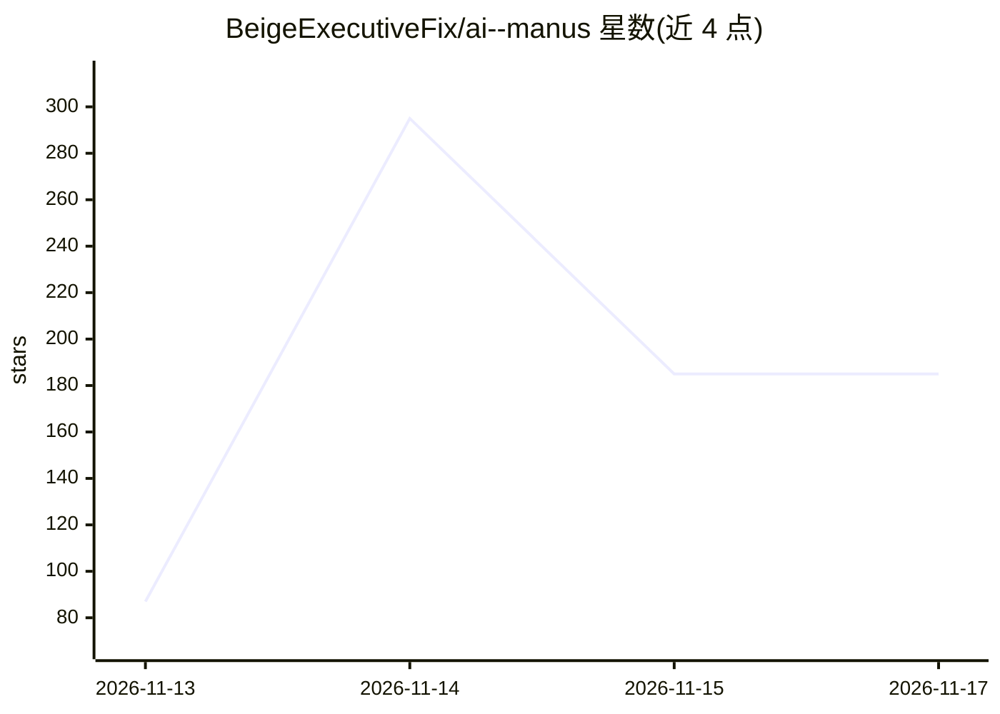

# BeigeExecutiveFix/ai--manus

⭐ 185 · Apache-2.0 · 推送 2026-11-15 · [GitHub](https://github.com/BeigeExecutiveFix/ai--manus) · 个人维护

**面向日常小任务的自主 AI Agent：自动执行代码与控制浏览器**

README 以营销式文案描述一个名为 Manus 的自主 AI Agent：声称可代用户编写并执行脚本、控制浏览器（打开网页、填表、抓取信息）、执行多步任务，定位为家庭、学习与轻量办公场景的后台个人助手，而非企业平台。文中给出兼容性表格（最低 4 GB 内存、双核 CPU）与六步上手流程，但均为通用描述；README 未提供任何安装命令、仓库结构、模型接入方式或可验证的实现细节，仅含下载与促销码字样。实际能力无法从 README 核实。

## 筛选速览

| 维度 | 判定 | 备注 |
|---|---|---|
| AI 角色 | `ai-native` | 本体是模型或模型工具 |
| 许可风险 | `permissive` | Apache-2.0 |
| 部署形态 | `None` |  |
| 模型依赖 | — | README 未给出锁定关系 |
| 硬件要求 | — | 无带数字的原话,不猜 |
| 安装摩擦 | `low` | 无编译、无系统依赖或容器化 |
| 成熟度 | — | 结构信号不足 |

## 能力要点

- 声称支持自主代码执行与浏览器控制（导航、填表、信息收集）
- 声称可在脚本与浏览器动作间衔接完成多步任务
- 给出兼容性表格：最低双核 CPU / 4 GB 内存
- 定位为家庭、学习与轻量工作的小规模任务助手

## 适用场景

- 让代理代为完成查网页、填表、整理文件等重复性小事
- 学习与研究中收集参考资料并运行小脚本
- 远程轻量办公中汇总多页面信息

## 场景标签

`AI 助手` `浏览器自动化` · 领域:效率与自动化

## 证据(README 行号)

> L10: - **Autonomous Code Execution:** Manus AI agent runs code on its own to complete tasks, so you can focus on decisio
> L18: Manus is an autonomous AI agent designed to run code and control a browser on your behalf. Instead of acting like a

## 星数曲线

2026-11-13 87 → 2026-11-17 185（+98）

---
*卡片 v1 · prompt 1.4 · 生成 2026-11-17 · 置信度 low · 依据 README sha `a3d88e202bf0` · [字段定义](../../DATASET.md)*
