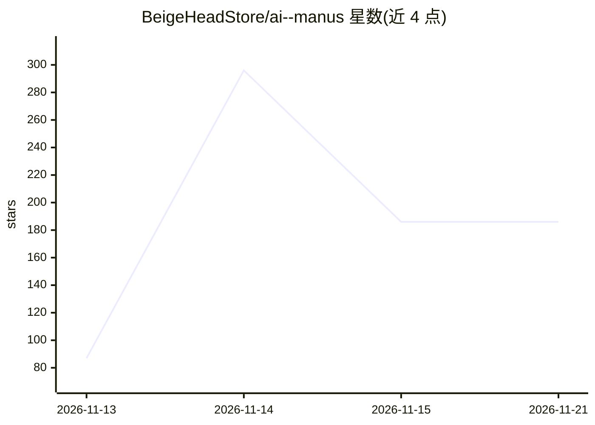

# BeigeHeadStore/ai--manus

⭐ 186 · Apache-2.0 · 推送 2026-11-15 · [GitHub](https://github.com/BeigeHeadStore/ai--manus) · 个人维护

**面向日常小任务的自主 AI Agent：自动执行代码与浏览器操作**

README 自述为自主 AI Agent 系统，在沙箱环境中运行工具与操作：可自主编写并执行脚本、控制浏览器完成导航/填表/信息收集，并执行多步骤任务。定位为个人助手而非企业平台，面向学生、远程工作者与多小项目用户的轻量场景。README 提供功能描述、兼容性表（最低 4GB 内存）与上手步骤，但未给出具体安装命令、模型接入方式或代码结构说明，工程实体不可验证。

## 筛选速览

| 维度 | 判定 | 备注 |
|---|---|---|
| AI 角色 | `ai-native` | 本体是模型或模型工具 |
| 许可风险 | `permissive` | Apache-2.0 |
| 部署形态 | `None` |  |
| 模型依赖 | — | README 未给出锁定关系 |
| 硬件要求 | — | 无带数字的原话,不猜 |
| 安装摩擦 | `low` | 无编译、无系统依赖或容器化 |
| 成熟度 | — | 结构信号不足 |

## 能力要点

- 自主执行代码与脚本（Autonomous Code Execution）
- 浏览器控制：导航、填表、信息收集
- 代码与浏览器操作可在同一任务流中衔接
- 跨会话保持任务模式的一致性

## 适用场景

- 整理研究资料、运行小脚本辅助学习
- 代替人工浏览多个网页收集信息
- 处理日常重复性小任务（文件整理、检查页面等）

## 场景标签

`AI 助手` `浏览器自动化` · 领域:效率与自动化

## 证据(README 行号)

> L10: - **Autonomous Code Execution:** Manus AI agent runs code on its own to complete tasks, so you can focus on decisio
> L18: Manus is an autonomous AI agent designed to run code and control a browser on your behalf. Instead of acting like a

## 星数曲线

2026-11-13 87 → 2026-11-21 186（+99）

---
*卡片 v1 · prompt 1.4 · 生成 2026-11-17 · 置信度 low · 依据 README sha `0f78ee3a5dd2` · [字段定义](../../DATASET.md)*
