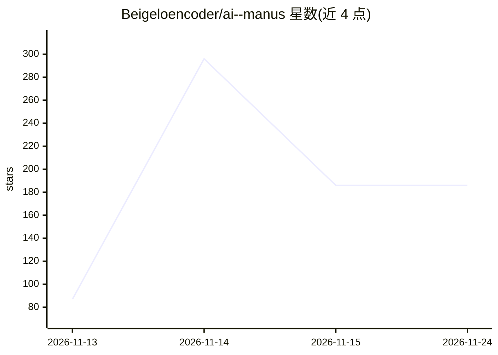

# Beigeloencoder/ai--manus

⭐ 186 · Apache-2.0 · 推送 2026-11-15 · [GitHub](https://github.com/Beigeloencoder/ai--manus) · 个人维护

**自主执行代码与浏览器操作的通用 AI Agent 助手**

Manus 是一个面向终端用户的自主 AI Agent：用户以自然语言下达指令，代理自行编写并执行脚本、操控浏览器（打开页面、填写表单、抓取信息），并可跨脚本与浏览器完成多步骤任务。定位为家庭、学习与轻量办公场景的后台个人助手，非企业级平台。README 列出最低 4GB 内存、双核 CPU 的兼容性要求，并给出配置、测试、维护等使用流程说明；但全文未提供具体的安装命令、代码入口或技术架构细节，仓库描述称其支持在沙箱环境中运行各类工具。

## 筛选速览

| 维度 | 判定 | 备注 |
|---|---|---|
| AI 角色 | `ai-native` | 本体是模型或模型工具 |
| 许可风险 | `permissive` | Apache-2.0 |
| 部署形态 | `None` |  |
| 模型依赖 | — | README 未给出锁定关系 |
| 硬件要求 | — | 无带数字的原话,不猜 |
| 安装摩擦 | `low` | 无编译、无系统依赖或容器化 |
| 成熟度 | — | 结构信号不足 |

## 能力要点

- 自主编写并执行代码完成任务的 Agent
- 代理操控浏览器：导航、填表、采集信息
- 脚本与浏览器动作可在同一流程中衔接
- 面向家庭/学习/轻办公的小规模场景定位

## 适用场景

- 让代理代替自己查网页、填表单、收集资料
- 自动执行小脚本与重复性日常任务
- 学习与研究中整理笔记、跑快速计算

## 场景标签

`AI 助手` `浏览器自动化` · 领域:效率与自动化

## 证据(README 行号)

> L18: Manus is an autonomous AI agent designed to run code and control a browser on your behalf. Instead of acting like a
> L10: - **Autonomous Code Execution:** Manus AI agent runs code on its own to complete tasks, so you can focus on decisio

## 星数曲线

2026-11-13 87 → 2026-11-24 186（+99）

---
*卡片 v1 · prompt 1.4 · 生成 2026-11-17 · 置信度 low · 依据 README sha `0f78ee3a5dd2` · [字段定义](../../DATASET.md)*
